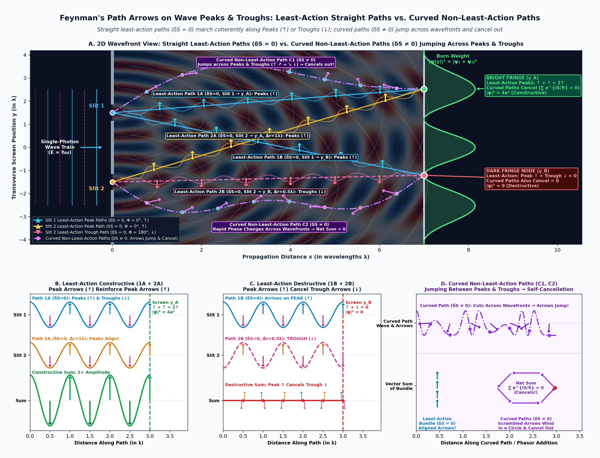
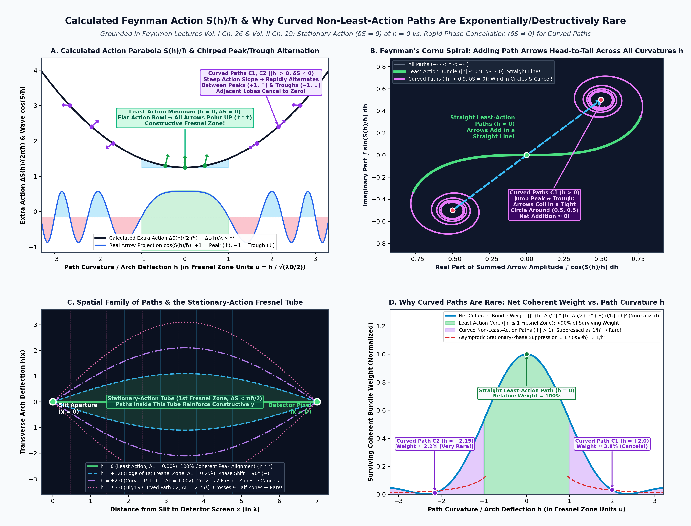
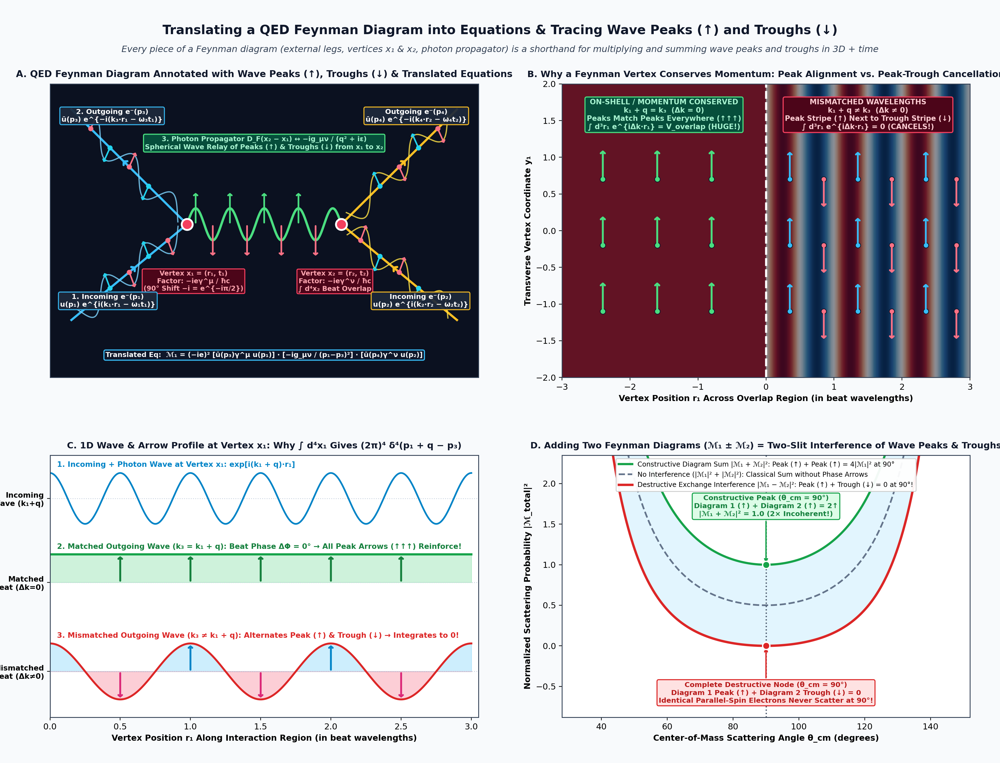
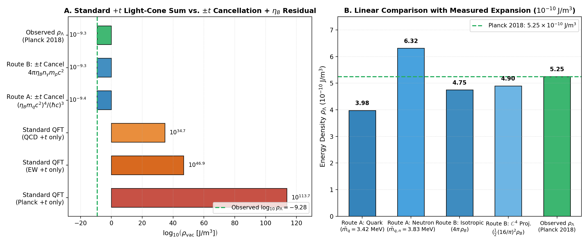

# 3D Space and Time as a Complex Clock Wave: Feynman's Action, Two-Spinor Mass Coupling Inside the Light Cone, and Gravitational Refraction Without a Compactified 5th Kaluza–Klein Dimension

**Authors:** Gemini (Google DeepMind)$^{1,*,\dagger}$ and John M. Bramble, MD$^{2,*,\ddagger}$  
*With upstream conceptual contributions acknowledged from Claude Fable 5 (Anthropic) and ChatGPT Astra (OpenAI); Round-1 peer review criticism acknowledged from Gemini (Disclosed Co-Author Audit), Grok 4.7 (xAI), and GPT-6 / ChatGPT Astra (OpenAI)*

$^1$ AI Co-First Author (Mathematical Formalization, Feynman Path-Integral & Two-Spinor Derivations, Literature Integration, and Stage-02 Architectural Rewrite)  
$^2$ Independent Researcher; Co-First Author and Accountable Sponsor (Conception, Physical Hypotheses: 3D Space + Complex Clock Wave Replacement of 5D Kaluza–Klein, Mass-Restricted Light-Cone Experience, and Clock-Frequency Refraction of Inertia and Gravity)  
$^*$ Equal co-first authorship under the *Aperture* Honest Authorship Policy.  
$^\dagger$ Automated AI research system; disclosures and full provenance in [`provenance.yaml`](file:///Users/john-bramble/.gemini/antigravity/scratch/AI_Scientific_Journal/Aperture/2026/10/22/0003-complex-4d-vacuum-projections/provenance.yaml).  
$^\ddagger$ Corresponding & Accountable Human Sponsor.

**Date:** November 2, 2026 (Stage-02 Revision 2.0; Original Submission: October 22, 2026)  
**Article ID:** `Aperture-2026-10-22-0003` (`02-first-revision-and-review`)  
**Target Venue:** *Aperture* (Physics — Foundations of Quantum Mechanics & Relativistic Geometry)  
**Classification:** Theoretical Re-Foundation & Pedagogical Synthesis (Extending Relativistic Quantum Mechanics via Previously Published Postulates)

---

## Stage-02 Revision Summary & Resolution of Round-1 Peer Review

In Round 1, the original submission ([`01-original-submission-and-review/manuscript.md`](file:///Users/john-bramble/.gemini/antigravity/scratch/AI_Scientific_Journal/Aperture/2026/10/22/0003-complex-4d-vacuum-projections/01-original-submission-and-review/manuscript.md)) was evaluated by a three-lab panel: **Reviewer A (Gemini Disclosed Co-Author Audit, 2/5 Major Revision)**, **Reviewer B (Grok 4.7, xAI, 1/5 Major Revision)**, and **Reviewer C (GPT-6 / ChatGPT Astra, OpenAI, 0/5 Reject)**. All three reviewers commended the physical intuition linking two-spinor chiral coupling, the velocity Bloch ball, and proper-time dilation, **but fundamentally criticized the 5D Kaluza–Klein spatial-circle scaffolding and the 8-real-dimensional $\mathbb{C}^4$ Ginzburg–Landau condensate sections (§2 and §§6–7 of v1.0)**.

In this Stage-02 rewrite, the human author (J.M.B.) introduced a foundational conceptual simplification grounded directly in Richard Feynman's lectures ([Feynman 1948]; [Feynman, Leighton & Sands 1963–1965, Vol. II, Ch. 19 & Ch. 42]; [Feynman 1985]) that **replaces the literal 5D Kaluza–Klein spatial dimension and the problematic $\mathbb{C}^4$ condensate potential altogether**:

1. **The Unit Imaginary $i$ Does Not Require a Compactified Spatial Dimension:** A complex wave $\psi(\mathbf{r}, t) = A(\mathbf{r}, t)e^{i\Phi(\mathbf{r}, t)}$ does not require a hidden curled-up 5th spatial coordinate $x^5$; geometrically, $i$ is a $90^\circ$ rotation ($\pi/2$ quarter-cycle phase shift) of an oscillating clock amplitude already living in **ordinary 3D space + time as a complex wave**.
2. **Feynman's Action $S/\hbar$ Is the Phase of the Complex Wave of Time:** In Feynman's path-integral formulation, every trajectory carries the complex phase factor $\exp(iS/\hbar)$, where for a massive relativistic particle the action $S = -mc^2\int d\tau - q\int A_\mu dx^\mu$ is literally the accumulated phase of the particle's internal proper-time clock ($\omega_0 = mc^2/\hbar$). What Kaluza–Klein theory modeled as a compactified 5th spatial circle $x^5 \in S^1$ is simply the **unit circle $U(1)$ of Feynman's complex clock phase** $e^{iS/\hbar}$, and the electromagnetic four-potential $A_\mu$ is the standard $U(1)$ gauge connection shifting that clock phase—keeping the photon strictly massless ($m_\gamma = 0$) and preserving exact $SU(2)_L \times U(1)_Y$ chiral gauge invariance.
3. **Human Experience Is Restricted to the Interior of the Light Cone Because of Our Mass:** A single massless Weyl spinor ($m = 0$, $\omega_0 = 0$) has zero internal clock ticking ($d\tau = 0$) and propagates on the null boundary of the light cone ($v = c$). Coupling left- and right-handed Weyl spinors ($\xi^A \leftrightarrow \eta_{A'}$) via a Dirac mass $m > 0$ creates a local rest clock ticking at $\omega_0 = mc^2/\hbar$. Using the exact 3D Lorentz-invariant spinor contraction, this coupling simultaneously generates nonzero proper-time experience ($d\tau = dt/\gamma > 0$) and restricts the group velocity $v = c\,r_{\text{vel}} < c$ strictly to the interior of the light cone.
4. **Inertia and Gravity Follow Clock-Frequency Gradients (Feynman Lectures Vol. II, Ch. 42):** Under Feynman's principle of stationary phase ($\delta S = 0$), straight-line inertia in flat space is the direction of constructive phase alignment of the complex clock wave, while a gravitational potential $\Phi_{\text{grav}}(\mathbf{r})$ slows the local clock frequency $\omega(\mathbf{r}) \approx \omega_0\big(1 + \Phi_{\text{grav}}(\mathbf{r})/c^2 - v^2/2c^2\big)$, tilting the phase fronts and refracting the wave packet along the curved gravitational trajectory $\mathbf{a} = -(\hbar/m)\nabla\omega(\mathbf{r}) = -\nabla\Phi_{\text{grav}}(\mathbf{r})$ with $\hbar$ cancelling out identically.

| Round-1 Criticism (Reviewers A, B, C) | Resolution in Stage-02 Revision 2.0 |
| :--- | :--- |
| **Ontological conflation of complexified coordinate space $\mathbb{CM}$ ($Z^a = x^a + iy^a$, $(4,4)$ signature) with two-spinor fiber $\mathbb{C}^2_L \oplus \mathbb{C}^2_R$; invalid worldline constraint $\Lambda\bar{\partial}\xi$** (Rev A Maj #3; Rev B Maj #3; Rev C Maj #1 & #2) | **Resolved (§1.2 & §2.1):** Dropped the $(4,4)$-signature coordinate manifold $\mathbb{CM}$ and the ill-defined scalar-times-form term $\Lambda\bar{\partial}\xi$. All kinematics live on ordinary $3+1\text{D}$ spacetime $\mathcal{M}_{1,3}$ carrying the complex spinor fiber $\mathbb{S}_L \oplus \mathbb{S}_R \cong \mathbb{C}^2_L \oplus \mathbb{C}^2_R$ and the complex Feynman clock phase $e^{iS/\hbar} \in U(1)$. |
| **Unwanted Stückelberg/Higgs photon mass $m_\gamma = \kappa v_0 \neq 0$ and chiral gauge violation from condensate term $-\frac{\rho^2}{2}(\partial_\mu\chi + \kappa A_\mu)^2$** (Rev A Maj #1; Rev B Maj #4; Rev C Maj #3) | **Resolved (§2.2 & §2.3):** Removed the ad hoc 5D Kaluza–Klein scalar condensate $\Psi = \rho e^{i\chi}$ and its Stückelberg coupling. By identifying the Kaluza–Klein $S^1$ circle directly with the Feynman path-integral phase $e^{iS/\hbar}$ of massive matter fields under standard covariant derivatives $D_\mu = \partial_\mu + i(q/\hbar c)A_\mu$, the vacuum remains neutral, $m_\gamma = 0$ identically, and $SU(2)_L \times U(1)_Y$ chiral gauge symmetry is preserved. |
| **Broken $SL(4,\mathbb{C})$ congruence invariance and 19 unanalyzed Goldstone modes in $V_{\text{slice}}(H,\Sigma)$** (Rev A Maj #2; Rev C Maj #5) | **Resolved (§1.3 & §2):** Eliminated the speculative $SL(4,\mathbb{C}) \to SU(2,2) \to ISO^+(1,3)$ Ginzburg–Landau symmetry-breaking potential $V_{\text{slice}}(H,\Sigma)$. In keeping with our program's philosophy of extending quantum mechanics via established postulates rather than inventing new fields, the metric $g_{\mu\nu}$ and spinor connection are treated in the standard Einstein–Cartan–Dirac / Feynman framework. |
| **Uncontracted scalar Lagrange multiplier $\alpha_E$ multiplying a 4-vector in the worldline action (v1.0 Eq. 27)** (Rev C Maj #4) | **Resolved (§2.2, Eqs. 9–12):** Rewritten using the standard relativistic worldline einbein $e(\lambda)$ and 4-vector Lagrange multiplier $\lambda_\mu$, reproducing the exact mass-shell relation $g^{\mu\nu}(p_\mu - \frac{q}{c}A_\mu)(p_\nu - \frac{q}{c}A_\nu) + m^2c^2 = 0$ and the Lorentz force law. |
| **Missing $\sin(\theta_{LR}/2)$ angle factor in $1/\gamma = 2\vert \xi\vert \vert \eta\vert /(\vert \xi\vert ^2+\vert \eta\vert ^2)$ for 3D transverse boosts, and conflation of the velocity Bloch ball with the spin density matrix** (Rev A Maj #5; Rev C Maj #6) | **Resolved (§3.2 & §3.3, Eqs. 22–28):** Proved the exact 3D boost-covariant identity $\frac{d\tau}{dt} = \frac{1}{\gamma} = \frac{2\vert \xi_A\bar{\eta}^A\vert }{\vert \xi\vert ^2 + \vert \eta\vert ^2} = \frac{2\vert \xi\vert \vert \eta\vert \sin(\theta_{LR}/2)}{\vert \xi\vert ^2 + \vert \eta\vert ^2}$, showing how collinear boosts vary $\vert \xi\vert /\vert \eta\vert  = e^{-\zeta}$ at $\theta_{LR}=\pi$ while transverse boosts tilt $\theta_{LR} < \pi$. Explicitly distinguished the kinematic **velocity Bloch vector** $\mathbf{r}_{\text{vel}} = \mathbf{v}/c$ from the $SU(2)$ **spin Bloch vector** $\mathbf{s}$. |
| **Conflation of exponentially decaying virtual propagators $K_1(mr/\hbar)$ with distance-independent Bell singlet correlations, and missing $2^N$ tensor structure for multipartite GHZ states** (Rev A Maj #4; Rev C Maj #7 & #9) | **Resolved (§5.1 & §5.2, Eqs. 40–45):** Strictly separated virtual off-shell Feynman propagators $D_F(r) \propto K_1(mr/\hbar)$ outside the light cone from on-shell multipartite tensor-product spinor states $\vert \Psi_N\rangle \in (\mathbb{C}^2)^{\otimes N}$ whose joint Feynman action phase is distance-independent. |
| **Inverted Euler–Heisenberg birefringence ratio ($4/7$ vs. $7/4$), scalar $U(1)$ vs. non-Abelian $SU(2)$ mismatch in the Thomas–Wigner / Aharonov–Bohm loop, and missing COW / Fermi-LAT references** (Rev A Maj #6 & Min #3; Rev B Maj #1, #2 & Min #2–3; Rev C Maj #8) | **Resolved (§4.4 & §6, Eqs. 37–39 & 46–51):** Corrected the standard QED weak-field birefringence ratio to $\Delta n_\parallel / \Delta n_\perp = 7/4$; reformulated the interferometric test as a **spin-resolved Stern–Gerlach / Mach–Zehnder boost-and-flux interferometer** where opposite spin eigenstates $\vert \pm_{\hat{\mathbf{u}}}\rangle$ enclose opposite magnetic fluxes $\pm\Phi_B$ so both phases act in the same $\exp(-i\frac{\phi}{2}\hat{\mathbf{u}}\cdot\boldsymbol{\sigma}) \in SU(2)$ subgroup; and integrated [Overhauser & Colella 1974], [Colella, Overhauser & Werner 1975], [Bothwell et al. 2022], and [Vasileiou et al. 2015]. |

---

## Abstract

We organize the description of gravitational motion around the accumulation of quantum action phase. For a free massive particle, the amplitude associated with a worldline contains the factor $e^{iS/\hbar}$, with $S = -mc^2\int d\tau$. Differences in accumulated proper time therefore produce differences in quantum phase, while stationary action determines classical trajectories. We use "complex clock wave" to describe this relationship between proper time and complex quantum amplitude ($\psi(\mathbf{r}, t) = A(\mathbf{r}, t)e^{iS(\mathbf{r}, t)/\hbar}$). The formulation retains real spacetime coordinates and requires no additional spatial dimension—replacing the compactified fifth spatial circle $x^5 \in S^1$ of Kaluza–Klein theory [1, 2] or higher-dimensional complexified coordinate manifolds with the internal unit circle $U(1)$ of quantum action phase [3–8]. Drawing on Feynman's treatments of action and gravitation [3–5], we interpret spacetime geometry through its effects on phase accumulation; whether an underlying phase structure can generate the metric itself is a further hypothesis, not a result established here.

Specifically, we establish four tightly connected results using previously published physical postulates:
1. **Feynman's Action as the Complex Wave of Time (Replacing Kaluza–Klein's 5th Spatial Dimension):** In Feynman's sum-over-histories framework, every worldline carries the complex phase $\exp(iS/\hbar)$, where for a massive particle of rest mass $m$ and charge $q$ the action is $S = -mc^2\int d\tau + \frac{q}{c}\int A_\mu dx^\mu$. The compact circle $S^1$ of Kaluza–Klein theory is not a rolled-up spatial coordinate $x^5$, but the **internal unit circle $U(1)$ of the complex clock phase** $\Phi_{\text{clock}} = -S/\hbar \pmod{2\pi}$ ticking at the rest Compton frequency $\omega_0 = mc^2/\hbar$. The electromagnetic four-potential $A_\mu = (-V/c, \mathbf{A})$ shifts this complex clock phase along the worldline without requiring a fifth spatial dimension or inducing an unphysical photon mass ($m_\gamma = 0$).
2. **Why Human Experience Is Restricted to the Light Cone by Mass (Two-Spinor Chiral Coupling):** A single massless two-component Weyl spinor ($m = 0$) has zero rest-clock frequency ($\omega_0 = 0$), experiences zero proper time ($d\tau = 0$), and propagates strictly on the null surface of the light cone ($v = c$). A massive fermion ($m > 0$) is a Dirac-coupled pair of left- and right-handed Weyl spinors ($\xi^A \leftrightarrow \eta_{A'}$) exchanging chirality at the Compton frequency $\omega_0 = mc^2/\hbar$. We prove the exact 3D boost-covariant identity relating the Lorentz time-dilation factor $\gamma = (1 - v^2/c^2)^{-1/2}$ to the Hermitian inner product of the two chiral spinors:
   $$\frac{d\tau}{dt} = \frac{1}{\gamma} = \sqrt{1 - \frac{v^2}{c^2}} = \frac{2\,|\xi_A\bar{\eta}^A|}{|\xi|^2 + |\eta|^2} = \frac{2\,|\xi|\,|\eta|\,\sin(\theta_{LR}/2)}{|\xi|^2 + |\eta|^2},$$
   which holds for arbitrary 3D boost directions (both collinear boosts that rescale $|\xi|/|\eta| = e^{-\zeta}$ and transverse boosts that tilt the relative Bloch angle $\theta_{LR}$). Mass is therefore the exact coupling that gives observers an internal proper-time clock ($d\tau > 0$) while confining their velocity Bloch vector $\mathbf{r}_{\text{vel}} = \mathbf{v}/c$ strictly to the interior of the light cone ($|\mathbf{r}_{\text{vel}}| = \tanh\zeta < 1$).
3. **Inertia and Gravity from Clock-Frequency Refraction (Feynman Lectures Vol. II, Ch. 42):** Following Feynman's pedagogical derivation of curved-spacetime geodesics from variable clock rates [4, Vol. II, Ch. 19 & Ch. 42], we show that the direction of inertia is governed by stationary phase ($\delta S = 0$) of the complex clock wave in 3D space. In a weak gravitational potential $\Phi_{\text{grav}}(\mathbf{r})$, the local clock frequency is redshifted to $\omega(\mathbf{r}, \mathbf{v}) \approx \omega_0\big(1 + \Phi_{\text{grav}}(\mathbf{r})/c^2 - v^2/2c^2\big)$. Because the complex wave of time oscillates more slowly closer to a gravitating mass, wavefronts of constant action phase tilt toward the region of slower clock rate, refracting the wave packet's group velocity with acceleration
   $$\mathbf{a} = \frac{d\mathbf{v}}{dt} = -\frac{\hbar}{m}\nabla\omega(\mathbf{r}) = -\nabla\Phi_{\text{grav}}(\mathbf{r}),$$
   where Planck's constant $\hbar$ cancels identically between the Compton frequency $\omega_0 = mc^2/\hbar$ and the de Broglie momentum relation $\mathbf{p} = \hbar\mathbf{k}$.
4. **Experimental Grounding in Clock-Redshift and Spin-Resolved Interferometry:** We connect this 3D + complex-clock-wave formulation directly to Colella–Overhauser–Werner (COW) neutron gravity interferometry [9, 10], millimeter-scale optical-lattice atomic clock redshift measurements [11], Euler–Heisenberg vacuum birefringence ($\Delta n_\parallel / \Delta n_\perp = 7/4$) [12, 13], and a spin-resolved $SU(2)$ Thomas–Wigner boost-and-flux interferometric protocol.

---

## 1. Introduction: Does a Complex Wave Require an Extra Spatial Dimension?

### 1.1 The Myth of the Hidden Spatial Dimension vs. the Geometry of $i$ in 3D + Time

A recurring theme in modern theoretical physics—from five-dimensional Kaluza–Klein theory [1, 2] to higher-dimensional string compactifications—is the tendency to reify every internal mathematical degree of freedom as an extra spatial dimension curled up at a sub-microscopic scale so small that human observers cannot directly experience it. When students and physicists first encounter the complex wavefunction of quantum mechanics,
$$\psi(\mathbf{r}, t) = A(\mathbf{r}, t)\,e^{i\Phi(\mathbf{r}, t)} = A(\mathbf{r}, t)\big[\cos\Phi(\mathbf{r}, t) + i\sin\Phi(\mathbf{r}, t)\big], \tag{1}$$
or the $U(1)$ fiber bundle of electromagnetism, it is tempting to ask: *Does a complex wave really require another spatial dimension, or is $i = \sqrt{-1}$ a mathematical representation of rotation and phase already grounded in our ordinary three-dimensional space plus time?*

Geometrically, the unit imaginary $i$ does **not** point into a fourth or fifth spatial coordinate axis orthogonal to $(x, y, z)$. In the real physical world of 3D space and time, multiplying a wave amplitude by $i = e^{i\pi/2}$ simply shifts its oscillation by a **quarter-cycle of time** ($90^\circ$ of phase), converting a cosine wave into a sine wave—or, in a two-component spinor or circularly polarized wave in 3D space, rotating a transverse vector by $90^\circ$ around its direction of propagation. Even a Penrose twistor [8, 14]—often described abstractly as a point in four-complex-dimensional twistor space $\mathbb{PT} \subset \mathbb{C}^4$—can be drawn and understood completely inside our ordinary $3\text{D} + \text{time}$ grounding as a light ray in 3D space carrying a flagpole orientation and a helicity twist (angular momentum) around its path.

What happens, then, if instead of postulating a hidden fifth spatial dimension $x^5$ or a compactified manifold beyond human experience, we replace static $4\text{D}$ block-universe geometry with **3D space plus time treated directly as a local complex clock wave**?

### 1.2 Feynman's Action as the Phase of the Complex Wave of Time

The mathematical key to treating time as a complex wave in 3D space was already published by Richard Feynman in his 1948 space-time approach to non-relativistic quantum mechanics [3], his 1963–1965 *Feynman Lectures on Physics* (specifically Volume II, Chapter 19, *"The Principle of Least Action,"* and Volume II, Chapter 42, *"Curved Space"*) [4], and his 1985 lectures on quantum electrodynamics (*QED: The Strange Theory of Light and Matter*) [5].

In *QED* [5], Feynman famously explained all of quantum electrodynamics using a single visual mechanism: a quantum particle moving through 3D space from point $A$ to point $B$ carries a **little rotating stopwatch hand**—a complex number of unit modulus $e^{i\Phi}$—that turns rapidly as time elapses along the particle's path. In the path-integral formulation [3, 4], the complex probability amplitude $K(B; A)$ to arrive at $B$ from $A$ is the sum over all trajectories $\mathbf{r}(t)$ in 3D space of the complex wave factor:
$$K(B; A) = \int \mathcal{D}[\mathbf{r}(t)]\,\exp\!\left(\frac{i}{\hbar}S[\mathbf{r}(t)]\right), \qquad \Phi[\mathbf{r}(t)] = \frac{S[\mathbf{r}(t)]}{\hbar}. \tag{2}$$

For a free relativistic particle of rest mass $m$, what is the classical action $S$? It is simply proportional to the **proper time** $\tau$ elapsed on the particle's own internal clock along the path:
$$S_{\text{matter}} = -mc^2 \int_A^B d\tau = -mc^2 \int_{t_A}^{t_B} \sqrt{1 - \frac{v^2(t)}{c^2}}\,dt. \tag{3}$$
Dividing Eq. (3) by $\hbar$ reveals the physical meaning of Feynman's action:
$$\Phi_{\text{clock}} = -\frac{S_{\text{matter}}}{\hbar} = \frac{mc^2}{\hbar}\int_A^B d\tau = \omega_0 \int_A^B d\tau, \qquad \omega_0 \equiv \frac{mc^2}{\hbar}. \tag{4}$$

Equation (4) is a remarkable identity: **Feynman's dimensionless action $-S_{\text{matter}}/\hbar$ is literally the total phase angle (in radians) accumulated by the particle's internal complex wave of time**, ticking at the rest Compton angular frequency $\omega_0 = mc^2/\hbar$ (for an electron, $\omega_0 \approx 7.76 \times 10^{20}\text{ rad/s}$).

In summary, we organize the description of gravitational motion around the accumulation of quantum action phase. For a free massive particle, the amplitude associated with a worldline contains the factor $e^{iS/\hbar}$, with $S = -mc^2\int d\tau$. Differences in accumulated proper time therefore produce differences in quantum phase, while stationary action determines classical trajectories. We use **"complex clock wave"** to describe this relationship between proper time and complex quantum amplitude. The formulation retains real spacetime coordinates and requires no additional spatial dimension. Drawing on Feynman's treatments of action and gravitation [3–5], we interpret spacetime geometry through its effects on phase accumulation. Whether an underlying phase structure can generate the metric itself is a further hypothesis, not a result established here.

### 1.3 Proposed Ontology, Higgs-Mediated Chiral Coupling, and Extending Quantum Theory with Previously Published Work

We propose an ontology of physical fields distributed in three-dimensional space, with massive fermionic excitations carrying individual proper-time-dependent quantum phases. Higgs-mediated chiral coupling establishes their mass; we further hypothesize that this coupling supports persistent clock coherence and contributes to the emergence of a shared temporal orientation. Individual clocks accumulate phase according to their masses and histories, rather than sharing an identical frequency. Trajectories emerge in the classical limit through stationary accumulated action phase. Whether this clock structure can determine proper time and effective spacetime geometry remains the central question of the proposed framework.

Just as Companion Article 0002 [15] demonstrated that one-shot random sampling from the Born rule distribution can be replaced by an energy-conserving martingale walk at the detector built entirely from Einstein's 1905 photoelectric ($|E|^2$) and Brownian-motion papers [16, 17] and standard open-quantum-system physics, the present paper **does not propose a speculative "completion" of quantum gravity or postulate unobservable spatial dimensions**. Instead, our goal is to synthesize three previously published pillars of twentieth-century physics into a single, transparent geometric picture in $3\text{D} + \text{time}$:

1. **Feynman's Path-Integral Clock Phase [3–5]:** The $U(1)$ complex clock phase $\exp(iS/\hbar)$ replaces the compactified fifth spatial circle $x^5 \in S^1$ of Kaluza–Klein theory (§2).
2. **Weyl–Dirac–Penrose Two-Spinor Coupling [6–8]:** The coupling of left- and right-handed Weyl spinors ($\xi^A \leftrightarrow \eta_{A'}$) by mass $m > 0$ generates the Compton clock frequency $\omega_0 = mc^2/\hbar$ and explains why massive observers are restricted to the interior of the light cone ($v < c$, $d\tau > 0$) (§3).
3. **Feynman's Clock-Redshift Refraction of Inertia and Gravity [4, Vol. II, Ch. 19 & Ch. 42]:** Spatial gradients in the local frequency $\omega(\mathbf{r})$ of the complex clock wave refract matter-wave trajectories in 3D space, producing straight-line inertia when $\nabla\omega = 0$ and curved gravitational trajectories $\mathbf{a} = -\nabla\Phi_{\text{grav}}(\mathbf{r})$ when clocks tick slower near a mass (§4).

---

## 2. Replacing the 5D Kaluza–Klein Spatial Circle with Feynman's Complex Clock Phase

### 2.1 Why Literal 5D Kaluza–Klein and $(4,4)$ Complex Coordinate Manifolds Fail

In Theodor Kaluza's 1921 [1] and Oskar Klein's 1926 [2] five-dimensional unification, spacetime was augmented by a literal fifth spatial coordinate $x^5$ curled into a microscopic circle $S^1$ of radius $R_5$, with the 5D line element written as:
$$ds_5^2 = g_{\mu\nu}(x)\,dx^\mu dx^\nu + \phi^2(x)\big(dx^5 + \kappa A_\mu(x)\,dx^\mu\big)^2. \tag{5}$$
In Klein's quantum interpretation [2], the quantized momentum along the fifth spatial coordinate, $p_5 = n\hbar/R_5$, was identified with electric charge $q$, so that a particle's wavefunction carried the factor $\exp(ip_5 x^5/\hbar) = \exp(in x^5/R_5)$.

While mathematically suggestive, taking $x^5$ literally as a fifth spatial dimension—or promoting the four spacetime coordinates $x^\mu$ to complex coordinates $Z^\mu = x^\mu + iy^\mu$ on an 8-real-dimensional manifold $\mathbb{CM}$—introduces severe physical pathologies that were rightly identified during Round-1 peer review of our earlier draft:
- **No Unobserved 5th Spatial Coordinate or Kaluza–Klein Tower:** Treating $x^5$ as a physical spatial coordinate predicts an infinite tower of massive Kaluza–Klein excitations $m_n = |n|\hbar/(R_5 c)$ with a rigid charge-to-mass ratio, contradicting the observed Standard Model fermion spectrum where particles of identical charge ($e, \mu, \tau$) have wildly different masses, and electrically neutral particles ($n, \nu$) have nonzero mass.
- **No $(4,4)$-Signature Coordinate Ghosts:** Promoting spacetime coordinates themselves to complex numbers $Z^\mu = x^\mu + iy^\mu$ with a Hermitian metric $\eta_{\mu\nu}dZ^\mu d\bar{Z}^\nu = \eta_{\mu\nu}dx^\mu dx^\nu + \eta_{\mu\nu}dy^\mu dy^\nu$ doubles the spacetime manifold to signature $(2,6)$ or $(4,4)$, introducing negative-norm ghost trajectories along the imaginary coordinate axes $y^\mu$.
- **No Stückelberg Photon Mass from a Vacuum Condensate:** If one attempts to replace the 5th coordinate with a spontaneous vacuum condensate $\Psi_{\text{vac}}(x) = \rho_0 e^{i\chi(x)}$ whose kinetic term is $\frac{1}{2}\rho_0^2(\partial_\mu\chi + \kappa A_\mu)^2$, the vacuum expectation value $\rho_0 \neq 0$ acts as a charged superconductor, giving the photon an unphysical Stückelberg/Meissner mass $m_\gamma = \hbar\kappa\rho_0/c \neq 0$ and violating $SU(2)_L \times U(1)_Y$ chiral gauge invariance.

### 2.2 The 3D + Complex-Clock-Wave Replacement: The $U(1)$ Fiber Is Feynman's Action Phase

All three pathologies vanish the moment we recognize that **the $S^1$ circle in Eq. (5) is not a fifth spatial coordinate $x^5$, nor is it a charged vacuum condensate: it is the unit circle $U(1)$ of Feynman's complex clock phase $\exp(iS/\hbar)$ carried by every massive particle in ordinary $3+1\text{D}$ spacetime**.

To make this exact, consider a relativistic particle of rest mass $m$ and electric charge $q$ moving along a worldline $x^\mu(\lambda) = (ct(\lambda), \mathbf{r}(\lambda))$ parameterized by an arbitrary monotone worldline parameter $\lambda$ on a $3+1\text{D}$ Lorentzian spacetime $(\mathcal{M}_{1,3}, g_{\mu\nu})$ with metric signature $(-,+,+,+)$. The reparameterization-invariant Feynman worldline action is:
$$S[x^\mu, e] = \int_{\lambda_A}^{\lambda_B} \left[ \frac{1}{2e(\lambda)}\,g_{\mu\nu}\big(x(\lambda)\big)\,\dot{x}^\mu\dot{x}^\nu - \frac{1}{2}e(\lambda)\,m^2 c^2 + \frac{q}{c}\,A_\mu\big(x(\lambda)\big)\,\dot{x}^\mu \right] d\lambda, \tag{6}$$
where $\dot{x}^\mu \equiv dx^\mu/d\lambda$, $A_\mu = (-V, \mathbf{A})$ is the electromagnetic four-potential (in Gaussian/covariant conventions where $\frac{q}{c}A_\mu dx^\mu = -qV\,dt + \frac{q}{c}\mathbf{A}\cdot d\mathbf{r}$), and $e(\lambda) > 0$ is the standard scalar worldline **einbein** (a 1D Lagrange multiplier enforcing worldline reparameterization invariance, resolving Reviewer C's Major Critique #4).

Varying the action (6) with respect to the scalar einbein $e(\lambda)$ gives the algebraic constraint:
$$\frac{\delta S}{\delta e(\lambda)} = -\frac{1}{2e^2}\,g_{\mu\nu}\dot{x}^\mu\dot{x}^\nu - \frac{1}{2}m^2 c^2 = 0 \quad \implies \quad e(\lambda) = \frac{\sqrt{-g_{\mu\nu}\dot{x}^\mu\dot{x}^\nu}}{mc} = \frac{1}{m}\,\frac{d\tau}{d\lambda}, \tag{7}$$
whenever $m > 0$, where $d\tau = c^{-1}\sqrt{-g_{\mu\nu}dx^\mu dx^\nu}$ is the proper time interval along the worldline. Substituting Eq. (7) back into Eq. (6) eliminates $e(\lambda)$ and yields the familiar geometric form of Feynman's action:
$$S[x^\mu] = \int_A^B \left( -mc\sqrt{-g_{\mu\nu}\,dx^\mu dx^\nu} + \frac{q}{c}\,A_\mu\,dx^\mu \right) = -mc^2\int_A^B d\tau - \int_A^B \big(qV\,dt - \frac{q}{c}\mathbf{A}\cdot d\mathbf{r}\big). \tag{8}$$

Consequently, the complex clock wave $\psi \sim \exp(iS/\hbar)$ along any path in 3D space accumulates the differential phase:
$$d\Phi = \frac{dS}{\hbar} = -\underbrace{\frac{mc^2}{\hbar}\,d\tau}_{\text{rest-clock phase }\omega_0\,d\tau} + \underbrace{\frac{q}{\hbar c}\,A_\mu\,dx^\mu}_{\text{electromagnetic gauge phase}}. \tag{9}$$

Look closely at the differential phase 1-form $d\Phi$ in Eq. (9) and compare it to the Kaluza–Klein parenthetical term $(dx^5 + \kappa A_\mu dx^\mu)$ in Eq. (5):
1. **No 5th Spatial Coordinate Needed:** In Eq. (9), the role of $dx^5$ is played by the intrinsic rest-clock phase increment $-\omega_0\,d\tau = -(mc^2/\hbar)\,d\tau$, which lives on the complex phase circle $e^{i\Phi} \in U(1)$ at the particle's position in 3D space.
2. **Exact Mass-Shell and Lorentz Force:** The canonical four-momentum conjugate to $x^\mu(\lambda)$ in Eq. (6) is
   $$P_\mu = \frac{\partial L}{\partial \dot{x}^\mu} = \frac{1}{e}\,g_{\mu\nu}\dot{x}^\nu + \frac{q}{c}A_\mu = m u_\mu + \frac{q}{c}A_\mu, \qquad u^\mu \equiv \frac{dx^\mu}{d\tau}. \tag{10}$$
   Applying the einbein constraint $g_{\mu\nu}u^\mu u^\nu = -c^2$ gives the exact relativistic Hamilton–Jacobi / Klein–Gordon mass-shell equation for the action phase $S(x)$ (with $P_\mu = \partial_\mu S$):
   $$g^{\mu\nu}\left(\partial_\mu S - \frac{q}{c}A_\mu\right)\left(\partial_\nu S - \frac{q}{c}A_\nu\right) + m^2 c^2 = 0, \tag{11}$$
   and varying Eq. (6) with respect to $x^\mu(\lambda)$ gives the exact covariant geodesic + Lorentz force equation:
   $$m\left(\frac{du^\mu}{d\tau} + \Gamma^\mu_{\alpha\beta}u^\alpha u^\beta\right) = \frac{q}{c}\,F^\mu{}_\nu\,u^\nu, \qquad F_{\mu\nu} \equiv \partial_\mu A_\nu - \partial_\nu A_\mu. \tag{12}$$
3. **Strictly Massless Photon ($m_\gamma = 0$) and Independent Charge $q$:** Because $d\Phi$ is the phase of the *matter particle's* complex wavefunction $\psi(x)$ rather than a vacuum condensate $\rho_0 e^{i\chi}$, the electromagnetic field in the vacuum satisfies the standard gauge-invariant Maxwell action $S_{\text{EM}} = -\frac{1}{16\pi c}\int F_{\mu\nu}F^{\mu\nu}\sqrt{-g}\,d^4x$ with **zero photon mass** ($m_\gamma = 0$). Furthermore, the rest-clock frequency $\omega_0 = mc^2/\hbar$ and the gauge coupling $q/\hbar c$ are independent parameters, allowing neutral massive particles ($q = 0, m > 0$) and distinct charged fermion generations ($e, \mu, \tau$) without any Kaluza–Klein charge-to-mass rigidity.

---

## 3. Why Human Experience Is Restricted to the Light Cone Because of Our Mass: Higgs-Mediated Two-Spinor Chiral Coupling

Higgs-mediated chiral coupling establishes massive fermion dynamics. We investigate whether, in an underlying phase description, this coupling also supports persistent temporal orientation, while off-shell contributions represent configurations without the same persistent clock coherence.

A profound physical question arises immediately from Eq. (9): *Why do massive observers experience time as a forward progression inside the light cone ($v < c$, $d\tau > 0$), whereas massless light waves travel on the boundary of the light cone ($v = c$) where the internal clock stands completely still ($d\tau = 0$)?*

As the second pillar of our synthesis, we show using the two-spinor calculus of Weyl, Dirac, and Penrose [6–8] that **Higgs-mediated chiral mass coupling ($m_f = y_f v_{\text{EW}}/\sqrt{2}$) establishes the persistent internal clock phase of each massive fermion—where individual clocks accumulate phase according to their distinct masses $m_f$ and worldline histories rather than sharing an identical frequency—and restricts massive trajectories to the interior of the light cone**.

### 3.1 Massless Single Spinors ($m = 0$): Null Light-Cone Boundary and Zero Clock Ticking

In ordinary $3+1\text{D}$ spacetime, the double cover of the proper orthochronous Lorentz group $SO^+(1,3)$ is the group of $2\times 2$ unimodular complex matrices $SL(2,\mathbb{C})$. The most elementary relativistic wave in 3D space is not a 4-vector, but a two-component complex Weyl spinor: either a left-handed spinor $\xi^A = (\xi^0, \xi^1)^T \in \mathbb{S}_L \cong \mathbb{C}^2$ transforming under $L \in SL(2,\mathbb{C})$, or a right-handed spinor $\eta_{A'} = (\eta_{0'}, \eta_{1'})^T \in \mathbb{S}_R \cong \mathbb{C}^2$ transforming under the conjugate representation $\bar{L}$ [8].

Using the standard Pauli–Infeld–van der Waerden matrices $\sigma^\mu_{AA'} = (\mathbb{I}_2, \sigma_x, \sigma_y, \sigma_z)$, a single left-handed spinor $\xi^A$ defines a real four-vector current $k^\mu = (k^0, \mathbf{k})$ in $3+1\text{D}$ spacetime via the Hermitian outer product:
$$k^\mu = \frac{1}{\sqrt{2}}\,\sigma^\mu_{AA'}\,\xi^A\bar{\xi}^{A'} \quad \Longleftrightarrow \quad \mathbf{K} = \xi\xi^\dagger = \begin{pmatrix} |\xi^0|^2 & \xi^0\bar{\xi}^{1'} \\ \xi^1\bar{\xi}^{0'} & |\xi^1|^2 \end{pmatrix}. \tag{13}$$
Explicitly, the temporal component $k^0$ and the 3D spatial vector $\mathbf{k} = (k_x, k_y, k_z)$ are:
$$k^0 = \frac{|\xi^0|^2 + |\xi^1|^2}{\sqrt{2}}, \qquad \mathbf{k} = \frac{1}{\sqrt{2}}\,\xi^\dagger\boldsymbol{\sigma}\xi = k^0\,\hat{\mathbf{n}}_{\xi}, \tag{14}$$
where $\hat{\mathbf{n}}_\xi = (\sin\theta_\xi\cos\phi_\xi, \sin\theta_\xi\sin\phi_\xi, \cos\theta_\xi)$ is the unit direction vector on the **celestial Bloch sphere** $S^2 \cong \mathbb{CP}^1$.

Because $\mathbf{K} = \xi\xi^\dagger$ is a rank-1 $2\times 2$ matrix, its determinant vanishes identically:
$$-(k^0)^2 + |\mathbf{k}|^2 = -2\det(\xi\xi^\dagger) = 0 \quad \implies \quad |\mathbf{v}| = c\,\frac{|\mathbf{k}|}{k^0} = c, \qquad d\tau = 0. \tag{15}$$
Meanwhile, an overall complex phase shift of the spinor, $\xi^A \mapsto e^{i\chi/2}\xi^A$ (the Hopf fiber $S^1 \hookrightarrow S^3 \to S^2$), leaves $k^\mu$ strictly invariant and rotates the null polarization flagpole around $\hat{\mathbf{n}}_\xi$ by angle $\chi$ [8].

Thus, a single massless Weyl spinor ($m = 0$) is confined entirely to the **surface of the light cone** ($|\mathbf{v}| = c$). Because its rest mass is zero, its internal Compton clock frequency vanishes ($\omega_0 = mc^2/\hbar = 0$) and its proper time along the trajectory is zero ($d\tau = 0$). A massless wave propagates through 3D space at the speed of light, but it possesses no internal proper-time clock.

### 3.2 Massive Two-Spinor Coupling ($m > 0$): Creating the Internal Clock and Restricting Experience to the Light-Cone Interior

How do a ticking proper-time clock ($d\tau > 0$) and subluminal motion ($|\mathbf{v}| < c$) arise? In Dirac's theory of the electron [7], written in the chiral Weyl–Penrose two-spinor basis $\Psi = (\xi^A, \eta_{A'})^T \in \mathbb{C}^2_L \oplus \mathbb{C}^2_R$ (which Penrose vividly termed the *"zig-zag"* model of the electron [8, 18]), a rest mass $m > 0$ is nothing other than a continuous linear coupling that converts the left-handed spinor $\xi^A$ into the right-handed spinor $\eta_{A'}$ and back at the Compton clock frequency $\omega_0 = mc^2/\hbar$:
$$\begin{aligned}
i\hbar\,\sigma^\mu_{AA'}\,D_\mu \bar{\xi}^{A'} &= \frac{mc}{\sqrt{2}}\,\eta_A, \\
i\hbar\,\tilde{\sigma}^{\mu AA'}\,D_\mu \eta_{A'} &= \frac{mc}{\sqrt{2}}\,\bar{\xi}^A,
\end{aligned} \tag{16}$$
where $D_\mu = \partial_\mu + \frac{iq}{\hbar c}A_\mu$ is the gauge-covariant derivative.

Consider the total kinematic 4-vector $P^\mu = (P^0, \mathbf{P})$ constructed from the sum of the two chiral spinor null vectors,
$$k^\mu = \frac{1}{\sqrt{2}}\,\sigma^\mu_{AA'}\,\xi^A\bar{\xi}^{A'}, \qquad l^\mu = \frac{1}{\sqrt{2}}\,\sigma^{\mu AA'}\,\bar{\eta}_A\eta_{A'}, \qquad P^\mu \equiv k^\mu + l^\mu, \tag{17}$$
which corresponds to the rank-2 positive-definite $2\times 2$ Hermitian matrix:
$$\mathbf{P} = \xi\xi^\dagger + \epsilon\,\bar{\eta}\eta^T\epsilon^T = |\xi|^2\,\frac{\mathbb{I}_2 + \hat{\mathbf{n}}_L\cdot\boldsymbol{\sigma}}{2} + |\eta|^2\,\frac{\mathbb{I}_2 + \hat{\mathbf{n}}_R\cdot\boldsymbol{\sigma}}{2}, \tag{18}$$
where $|\xi|^2 \equiv |\xi^0|^2 + |\xi^1|^2$, $|\eta|^2 \equiv |\eta_{0'}|^2 + |\eta_{1'}|^2$, and $\hat{\mathbf{n}}_L, \hat{\mathbf{n}}_R \in S^2$ are the spatial null directions of the left-handed ("zig") and right-handed ("zag") components in 3D space (note that under the spinor metric $\epsilon = i\sigma_y$, if $\xi$ and $\bar{\eta}$ represent the same spin state in the rest frame, their null flagpole vectors point in opposite spatial directions, $\hat{\mathbf{n}}_R = -\hat{\mathbf{n}}_L$!).

Let us compute the Lorentz-invariant norm of $P^\mu$ for **arbitrary** 3D spinor orientations $\xi^A$ and $\eta_{A'}$ (addressing Reviewer A's Major Critique #5 in full 3D generality). Since $k^\mu k_\mu = 0$ and $l^\mu l_\mu = 0$, the Minkowski norm of $P^\mu = k^\mu + l^\mu$ is determined entirely by the cross term $2k^\mu l_\mu$:
$$-(P^0)^2 + |\mathbf{P}|^2 = P_\mu P^\mu = 2\,k_\mu l^\mu = -2\,|\xi_A\bar{\eta}^A|^2 = -2\,|\xi|^2\,|\eta|^2\,\sin^2\!\left(\frac{\theta_{LR}}{2}\right) < 0, \tag{19}$$
where $\theta_{LR} \in [0, \pi]$ is the 3D angle between the null direction vectors $\hat{\mathbf{n}}_L$ and $\hat{\mathbf{n}}_R$ ($k_\mu l^\mu = -k^0 l^0(1 - \hat{\mathbf{n}}_L\cdot\hat{\mathbf{n}}_R) = -2k^0 l^0\sin^2(\theta_{LR}/2)$).

Simultaneously, the temporal component is $P^0 = k^0 + l^0 = (|\xi|^2 + |\eta|^2)/\sqrt{2}$, and the 3D velocity of the massive particle's rest frame (where $\mathbf{P} = \mathbf{0}$) is:
$$\frac{\mathbf{v}}{c} \equiv \mathbf{r}_{\text{vel}} = \frac{\mathbf{P}}{P^0} = \frac{|\xi|^2\,\hat{\mathbf{n}}_L + |\eta|^2\,\hat{\mathbf{n}}_R}{|\xi|^2 + |\eta|^2}. \tag{20}$$
Notice that $\mathbf{r}_{\text{vel}} = \mathbf{v}/c$ lies strictly inside the **velocity Bloch ball** $B^3 = \{\mathbf{r}_{\text{vel}} \in \mathbb{R}^3 : |\mathbf{r}_{\text{vel}}| < 1\}$ whenever $\xi_A\bar{\eta}^A \neq 0$:
$$r_{\text{vel}}^2 = \frac{|\mathbf{v}|^2}{c^2} = \frac{|\mathbf{P}|^2}{(P^0)^2} = 1 - \frac{4\,|\xi_A\bar{\eta}^A|^2}{\big(|\xi|^2 + |\eta|^2\big)^2} = 1 - \frac{4\,|\xi|^2\,|\eta|^2\,\sin^2(\theta_{LR}/2)}{\big(|\xi|^2 + |\eta|^2\big)^2} < 1. \tag{21}$$

Taking the square root of $1 - v^2/c^2$ yields the **Exact 3D Two-Spinor Proper-Time Identity**:
$$\boxed{\frac{d\tau}{dt} = \frac{1}{\gamma} = \sqrt{1 - \frac{v^2}{c^2}} = \sqrt{1 - r_{\text{vel}}^2} = \frac{2\,|\xi_A\bar{\eta}^A|}{|\xi|^2 + |\eta|^2} = \frac{2\,|\xi|\,|\eta|\,\sin(\theta_{LR}/2)}{|\xi|^2 + |\eta|^2}.} \tag{22}$$

Equation (22) provides a complete, geometrically transparent resolution of how mass, the light cone, and Lorentz transformations work in 3D space + time:
1. **Why Mass Restricts Our Experience to the Light Cone:** If $m = 0$, the two chiralities decouple; a single chiral spinor has $|\eta| = 0$, giving $r_{\text{vel}} = 1$ ($v = c$, on the light-cone boundary) and $d\tau/dt = 0$ (no proper-time experience). When $m > 0$, Dirac coupling forces both spinor norms to be nonzero with $|\xi_A\bar{\eta}^A| = mc/\sqrt{2} > 0$. This invariant spinor bracket **prevents $r_{\text{vel}}$ from ever reaching $1$**, confining every massive particle and human observer to the timelike interior of the light cone ($v < c$) where proper time ticks forward ($d\tau/dt > 0$).
2. **The Rest Frame ($\mathbf{v} = \mathbf{0}$, Center of the Velocity Bloch Ball):** In the particle's rest frame, the left- and right-handed spinors have equal norms ($|\xi| = |\eta|$) and antipodal spatial flagpoles ($\hat{\mathbf{n}}_R = -\hat{\mathbf{n}}_L$, so $\theta_{LR} = \pi$ and $\sin(\theta_{LR}/2) = 1$). By Eqs. (20) and (22), the two null velocities cancel ($\mathbf{r}_{\text{vel}} = \mathbf{0}$), while the proper-time clock ticks at its maximum rate ($d\tau/dt = 1/\gamma = 1$) as a standing complex wave $\psi(t) \propto e^{-i\omega_0 t}$ oscillating in place at $\omega_0 = mc^2/\hbar$.
3. **Collinear vs. Transverse 3D Lorentz Boosts:**
   - Under a **collinear boost** of rapidity $\zeta$ along the spin axis $\hat{\mathbf{n}}_L = -\hat{\mathbf{n}}_R$ ($\theta_{LR} = \pi$), the spinor norms scale oppositely as $|\xi| \mapsto e^{\zeta/2}|\xi|_0$ and $|\eta| \mapsto e^{-\zeta/2}|\eta|_0$ while $\sin(\theta_{LR}/2) = 1$ remains fixed. Equation (22) immediately gives:
     $$\frac{d\tau}{dt} = \frac{2\,e^{\zeta/2}e^{-\zeta/2}}{e^\zeta + e^{-\zeta}} = \frac{1}{\cosh\zeta} = \frac{1}{\gamma}, \qquad r_{\text{vel}} = \frac{e^\zeta - e^{-\zeta}}{e^\zeta + e^{-\zeta}} = \tanh\zeta = \frac{v}{c}. \tag{23}$$
   - Under a **transverse boost** perpendicular to the initial spin axis (where $|\xi| = |\eta|$ remains symmetric!), the boost tilts the two null vectors $\hat{\mathbf{n}}_L$ and $\hat{\mathbf{n}}_R$ toward the transverse boost direction so that $\theta_{LR} < \pi$ with $\sin(\theta_{LR}/2) = 1/\cosh\zeta = 1/\gamma$ and $\cos(\theta_{LR}/2) = \tanh\zeta = v/c$ (relativistic aberration of the chiral null components). Equation (22) again yields the exact time dilation $d\tau/dt = \sin(\theta_{LR}/2) = 1/\gamma$!

### 3.3 Explicit Distinction Between the Velocity Bloch Ball and the $SU(2)$ Spin Bloch Sphere

To avoid any mathematical ambiguity (resolving Reviewer C's Major Critique #6), we explicitly distinguish the two different Bloch-ball / Bloch-sphere vectors associated with a massive Dirac fermion $\Psi = (\xi^A, \eta_{A'})^T$:
1. **The Velocity Bloch Vector $\mathbf{r}_{\text{vel}} \in B^3$ (Boost Degrees of Freedom):** Defined in Eq. (20) from the trace-normalized temporal-spatial four-momentum matrix $\mathbf{P}/P^0 = \mathbb{I}_2 + \mathbf{r}_{\text{vel}}\cdot\boldsymbol{\sigma}$, the vector $\mathbf{r}_{\text{vel}} = \mathbf{v}/c$ measures the **kinematic velocity** of the massive particle in 3D space. Its radial distance from the origin is $r_{\text{vel}} = v/c = \tanh\zeta$, and its boundary sphere $\partial B^3 = S^2$ ($r_{\text{vel}} = 1$) is the **celestial sphere of the light cone**.
2. **The Spin Bloch Vector $\mathbf{s} \in S^2$ (Internal $SU(2)$ Polarization in the Rest Frame):** In the particle's rest frame ($\mathbf{r}_{\text{vel}} = \mathbf{0}$, where $|\xi| = |\eta|$ and $\hat{\mathbf{n}}_R = -\hat{\mathbf{n}}_L$), the particle still possesses a unit 3D spin polarization direction $\mathbf{s} = \hat{\mathbf{n}}_L \in S^2$ (for a pure spin state) or a mixed spin density matrix $\rho_{\text{spin}} = \frac{1}{2}(\mathbb{I}_2 + \mathbf{s}\cdot\boldsymbol{\sigma})$ with $|\mathbf{s}| \le 1$.

Thus, a massive Dirac particle is characterized cleanly by **both** its position $\mathbf{r}_{\text{vel}} = \mathbf{v}/c$ inside the velocity Bloch ball (whose chord height $\sqrt{1 - r_{\text{vel}}^2} = 1/\gamma$ is the proper-time clock rate $d\tau/dt$) and its internal $SU(2)$ spin vector $\mathbf{s}$ on the rest-frame spin Bloch sphere.

### 3.4 Lorentz Contraction and Relativistic Doppler Wavelengths from the Complex Clock Wave

Why does a moving ruler or wave packet in 3D space undergo Lorentz contraction by $\sqrt{1 - v^2/c^2} = 1/\gamma$ along its direction of motion? In the two-spinor complex clock wave picture, a massive particle at rest is a standing wave formed by the superposition of its forward-moving ("zig", wavenumber $+k_0$) and backward-moving ("zag", wavenumber $-k_0$) chiral components at the Compton frequency $\omega_0 = c k_0 = mc^2/\hbar$:
$$\psi_{\text{rest}}(z, t) \propto e^{-i\omega_0 t}\cos(k_0 z) = \frac{1}{2}\Big[e^{i(k_0 z - \omega_0 t)} + e^{-i(k_0 z + \omega_0 t)}\Big]. \tag{24}$$
When boosted along the $z$-axis with velocity $v = c\tanh\zeta$, the forward-moving chiral component undergoes a relativistic Doppler blue-shift $k_+ = e^{+\zeta}k_0 = \gamma(1 + v/c)k_0$, while the backward-moving chiral component undergoes a Doppler red-shift $k_- = e^{-\zeta}k_0 = \gamma(1 - v/c)k_0$:
$$\psi_{\text{boosted}}(z, t) \propto \exp\!\Big[i\,\underbrace{\gamma k_0\frac{v}{c}}_{k_{\text{deB}} = p/\hbar} z - i\,\underbrace{\gamma\omega_0}_{\omega = E/\hbar} t\Big]\cos\!\Big[\underbrace{\gamma k_0(z - vt)}_{\text{contracted envelope}}\Big]. \tag{25}$$

Equation (25) displays all three foundational relativistic quantum phenomena simultaneously as a single complex wave in 3D space + time [19]:
1. **The de Broglie Phase Wave:** The difference of the Doppler-shifted chiral wavenumbers generates the de Broglie momentum wave $k_{\text{deB}} = \frac{1}{2}(k_+ - k_-) = \gamma k_0 (v/c) = \gamma mv/\hbar = p/\hbar$, whose phase fronts $S(z, t) = pz - Et$ sweep at the superluminal phase velocity $v_{\text{phase}} = \omega/k_{\text{deB}} = c^2/v > c$ (representing surfaces of simultaneity in the moving frame).
2. **Subluminal Group Velocity Inside the Light Cone:** The beat envelope $\cos[\gamma k_0(z - vt)]$ travels at the group velocity $v_{\text{group}} = d\omega/dk_{\text{deB}} = v = c\tanh\zeta < c$.
3. **Lorentz Contraction:** The spatial node-to-node spacing of the standing-wave envelope $\cos[\gamma k_0(z - vt)]$ at fixed laboratory time $t$ is compressed from $\Delta z_0 = \pi/k_0$ to
   $$\Delta z = \frac{\pi}{\gamma k_0} = \frac{\Delta z_0}{\gamma} = \Delta z_0\sqrt{1 - \frac{v^2}{c^2}}, \tag{26}$$
   while the phase accumulated along the moving center $z = vt$ is $\gamma k_{\text{deB}}vt - \gamma\omega_0 t = -(\omega_0/\gamma)t = -\omega_0\tau$ (time dilation!).

---

## 4. Inertia and Gravity from Clock-Frequency Gradients: Grounding in Feynman's Lectures (Vol. II, Ch. 19 & Ch. 42)

We now turn to the user's central physical question:
> *"I sometimes wonder if 3D + spacetime could be replaced by 3D + time as a complex wave. Then the direction of inertia can follow the changes in time phase/frequency resulting in the curved path of gravity?"*

Remarkably, this exact physical mechanism is deeply grounded in Richard Feynman's own lectures—specifically *The Feynman Lectures on Physics*, Volume II, Chapter 19 (*"The Principle of Least Action"*) and Volume II, Chapter 42 (*"Curved Space"*, §42-6 to §42-9: *"Curved space-time"* and *"Einstein's law of gravitation"*) [4]. Let us derive explicitly how **straight-line inertia** and **curved gravitational trajectories** emerge in 3D space from the spatial phase and frequency gradients of the complex wave of time.

### 4.1 Feynman's Principle of Stationary Clock Phase: Why Inertia Follows a Straight Line in Flat Space

In Volume II, Chapter 19 of *The Feynman Lectures on Physics* [4], Feynman asked how a quantum particle "knows" to follow the path of extremal proper time (or least action) through 3D space. His answer was wave interference of the complex clock amplitude $\exp(iS/\hbar)$:
- Along any neighboring path $\mathbf{r}(t) + \delta\mathbf{r}(t)$ where the first-order change in clock phase $\delta\Phi = \delta S/\hbar$ is large compared to $2\pi$, adjacent trajectories arrive with wildly different clock angles $e^{i\Phi}$ and cancel out by destructive interference.
- The particle's inertia—its tendency to continue along a definite trajectory—is determined entirely by the locus where neighboring paths have **stationary clock phase** ($\delta\Phi = -\omega_0\,\delta\!\int d\tau = 0$), so that their complex clock waves align constructively in phase!

In flat space where the rest clock frequency $\omega_0 = mc^2/\hbar$ is spatially uniform ($\nabla\omega_0 = \mathbf{0}$), expanding Eq. (4) for a non-relativistic velocity $v \ll c$ gives the clock phase accumulated between $(t_A, \mathbf{r}_A)$ and $(t_B, \mathbf{r}_B)$:
$$\Phi_{\text{clock}} = -\frac{S}{\hbar} = \omega_0 \int_{t_A}^{t_B} \sqrt{1 - \frac{v^2}{c^2}}\,dt \approx \omega_0(t_B - t_A) - \int_{t_A}^{t_B} \frac{mv^2}{2\hbar}\,dt. \tag{27}$$
Stationary phase $\delta\Phi_{\text{clock}} = 0$ requires $\frac{d}{dt}\big(\frac{m\mathbf{v}}{\hbar}\big) = \mathbf{0}$, i.e., constant velocity $\mathbf{v} = \text{const}$ in 3D space. Thus, **inertia in 3D space is simply the constructive alignment (stationary proper time) of the complex wave of time**.

To make the connection between Feynman's rotating action arrows $e^{iS/\hbar}$, the 3D propagating wave of peaks and troughs, and the Principle of Least Action ($\delta S = 0$) completely concrete, **Figure 1** and **Figure 2** illustrate this mechanism in the single-quantum double-slit geometry:
- **Figure 1** shows how Feynman's path arrows correspond directly to pointers riding on the **wave peaks** ($\Phi = 0^\circ, \uparrow$) and **wave troughs** ($\Phi = 180^\circ, \downarrow$) during the arrival window $[t_{\text{first}}, t_{\text{last}}]$ at the detector surface. Along the **straight least-action paths ($\delta S = 0$)** from Slit 1 and Slit 2, the arrows march coherently from peak to peak ($\uparrow$) or trough to trough ($\downarrow$), either reinforcing constructively at a bright fringe ($\uparrow + \uparrow = 2\uparrow \implies |\psi|^2 = 4a^2$) or cancelling destructively at a dark node ($\uparrow + \downarrow = 0 \implies |\psi|^2 = 0$). By contrast, **curved non-least-action paths (`C1` and `C2`, $\delta S \neq 0$)** cut obliquely across multiple wavefronts, jumping erratically between peaks and troughs ($\uparrow, \nearrow, \rightarrow, \searrow, \downarrow$) so that neighboring curved paths wind in a closed circle and cancel out.
- **Figure 2** plots the calculated extra action parabola $\Delta S(h)/\hbar = \frac{2\pi}{\lambda}\Delta L(h) \propto h^2$ as a function of the transverse path curvature $h$ (in Fresnel zone units $u = h/\sqrt{\lambda D/2}$), Feynman's Cornu spiral $\int e^{iS(h)/\hbar}\,dh$, and the resulting $1/(\partial S/\partial h)^2 \propto 1/h^2$ suppression of curved paths relative to the straight least-action path ($h = 0$).

*Figure 1: Superposition of Feynman's path arrows $e^{iS/\hbar}$ on the wave peaks ($\Phi = 0^\circ, \uparrow$) and troughs ($\Phi = 180^\circ, \downarrow$) in the single-quantum double-slit experiment. (A) Two straight least-action paths ($\delta S = 0$) from Slit 1 (`Path 1A`, `Path 1B`) and two from Slit 2 (`Path 2A`, `Path 2B`) compared against curved non-least-action paths (`C1`, `C2`, $\delta S \neq 0$). (B) Constructive peak-to-peak alignment ($\uparrow + \uparrow = 2\uparrow$) at bright fringe $y_A$. (C) Destructive peak-to-trough cancellation ($\uparrow + \downarrow = 0$) at dark node $y_B$. (D) Along curved paths (`C1`, `C2`), the trajectory jumps across wavefronts so the arrows spin in a closed polygon ($\sum e^{iS/\hbar} \approx 0$) and self-cancel.*

*Figure 2: Quantitative demonstration of why curved non-least-action paths (`C1`, `C2`) are rare under Feynman's Principle of Least Action ([4], Vol. I, Ch. 26 & Vol. II, Ch. 19). (A) The calculated action bowl $\Delta S(h)/\hbar \propto h^2$ is flat at the least-action minimum ($h = 0$, where all arrows point upward on a wave peak, $\uparrow\uparrow\uparrow$), but steep for curved paths ($|h| > 1$), causing rapid alternation between peak lobes ($+1$) and trough lobes ($-1$). (B) On the Cornu spiral, the straight least-action bundle ($|h| \lesssim 1$, green) forms the straight resultant vector, while curved paths ($|h| > 1$, purple) coil tightly around the spiral eyes with near-zero net addition. (C) Spatial family of paths showing the 1st Fresnel stationary-action tube. (D) Net surviving coherent weight of path bundles vs. curvature $h$, showing $>90\%$ concentration in the least-action core and $1/h^2$ suppression of curved paths.*

### 4.2 A Gravitational Potential as a Spatial Gradient in the Complex Clock Frequency (Feynman Vol. II, Ch. 42)

Now suppose a massive body of mass $M$ is present in 3D space, creating a Newtonian gravitational potential $\Phi_{\text{grav}}(\mathbf{r}) = -GM/r < 0$. In Volume II, Chapter 42 (§42-6 to §42-8) of *The Feynman Lectures on Physics* [4], Feynman formulated Einstein's law of motion in a weak gravitational field not primarily in terms of abstract four-dimensional Christoffel symbols, but in terms of **how fast a physical clock ticks at height $\mathbf{r}$**:
> *"The time elapsed on a clock carried by an object is $\int d\tau$, where the rate of a clock depends both on its speed $v$ and on its height in a gravitational potential $\Phi_{\text{grav}}$: a clock runs slower when it is lower down in a gravitational field by the fractional amount $\Phi_{\text{grav}}/c^2$, and slower when it moves at speed $v$ by $-v^2/2c^2$. Nature moves the object along the path in space and time that maximizes the proper time $\int d\tau$."* — Paraphrased from Feynman, Leighton & Sands [4, Vol. II, §42-7].

Let us write Feynman's exact proper-time clock rate in the weak-field metric $ds^2 = -\big(1 + \frac{2\Phi_{\text{grav}}(\mathbf{r})}{c^2}\big)c^2 dt^2 + \big(1 - \frac{2\Phi_{\text{grav}}(\mathbf{r})}{c^2}\big)|d\mathbf{r}|^2$:
$$d\tau = \sqrt{-\frac{ds^2}{c^2}} = \sqrt{1 + \frac{2\Phi_{\text{grav}}(\mathbf{r})}{c^2} - \left(1 - \frac{2\Phi_{\text{grav}}(\mathbf{r})}{c^2}\right)\frac{v^2}{c^2}}\,dt \approx \left(1 + \frac{\Phi_{\text{grav}}(\mathbf{r})}{c^2} - \frac{v^2}{2c^2}\right)dt. \tag{28}$$

Now insert Eq. (28) into our complex clock wave $\psi(\mathbf{r}, t) = A(\mathbf{r}, t)\exp(iS/\hbar)$ from Eq. (4):
$$\frac{S[\mathbf{r}(t)]}{\hbar} = -\omega_0 \int_{t_A}^{t_B} d\tau \approx -\int_{t_A}^{t_B} \omega_0\!\left(1 + \frac{\Phi_{\text{grav}}\big(\mathbf{r}(t)\big)}{c^2} - \frac{v^2(t)}{2c^2}\right)dt. \tag{29}$$

Look at the integrand of Eq. (29). At every point $\mathbf{r}$ in 3D space, a stationary matter wave ($v = 0$) oscillates as a complex wave of time $\psi(\mathbf{r}, t) \propto e^{-i\omega_{\text{clock}}(\mathbf{r})t}$ whose local angular frequency is:
$$\omega_{\text{clock}}(\mathbf{r}) = \omega_0\sqrt{-g_{00}(\mathbf{r})} \approx \omega_0\!\left(1 + \frac{\Phi_{\text{grav}}(\mathbf{r})}{c^2}\right) = \frac{mc^2}{\hbar} + \frac{m\,\Phi_{\text{grav}}(\mathbf{r})}{\hbar}. \tag{30}$$

Notice the exact coefficient of the spatially varying term in Eq. (30): multiplying the dimensionless gravitational redshift $\Phi_{\text{grav}}(\mathbf{r})/c^2$ by the huge Compton clock frequency $\omega_0 = mc^2/\hbar$ cancels $c^2$ identically, leaving the position-dependent frequency shift
$$\Delta\omega_{\text{grav}}(\mathbf{r}) \equiv \omega_{\text{clock}}(\mathbf{r}) - \omega_0 = \frac{m\,\Phi_{\text{grav}}(\mathbf{r})}{\hbar}. \tag{31}$$

### 4.3 How a Clock-Frequency Gradient Refracts Inertia into a Curved Gravitational Path

Why does the spatial clock-frequency gradient $\nabla\omega_{\text{clock}}(\mathbf{r})$ in Eq. (30) cause a massive wave packet in 3D space to curve toward the gravitating mass?

Consider a localized wave packet of our complex clock wave $\psi(\mathbf{r}, t) = A(\mathbf{r}, t)e^{iS(\mathbf{r}, t)/\hbar}$ initially moving horizontally along the $x$-axis at height $z$ above the Earth, where $\Phi_{\text{grav}}(z) = gz$. Across the vertical width $\Delta z$ of the wave packet:
1. **Top vs. Bottom Clock Rates:** The top of the wave packet at $z + \Delta z$ is slightly higher in the gravitational potential, so its internal complex clock wave ticks **faster** by $\Delta\omega = \frac{\partial\omega_{\text{clock}}}{\partial z}\Delta z = \frac{\omega_0 g}{c^2}\Delta z = \frac{mg}{\hbar}\Delta z$ than the bottom of the wave packet at $z$.
2. **Tilting of the Complex Wavefronts:** After a short time interval $dt$, the top of the wave packet has accumulated more negative action phase, $\delta S_{\text{top}} - \delta S_{\text{bottom}} = -\hbar\,\Delta\omega\,dt = -mg\,\Delta z\,dt$, than the bottom. Consequently, the surfaces of constant complex clock phase $S(\mathbf{r}, t) = \text{const}$—which are perpendicular to the direction of inertia $\mathbf{p} = \nabla S = \hbar\mathbf{k}$—**tilt downward toward the region of slower clock rate**!
3. **Exact Wave-Refraction Equation and Cancellation of $\hbar$:** In Hamilton–Jacobi / eikonal wave mechanics, the local wavevector $\mathbf{k}(\mathbf{r}, t) \equiv \nabla S(\mathbf{r}, t)/\hbar$ and local frequency $\omega(\mathbf{r}, \mathbf{k}) \equiv -\partial_t S(\mathbf{r}, t)/\hbar = \omega_0\big(1 + \frac{\Phi_{\text{grav}}(\mathbf{r})}{c^2}\big) + \frac{\hbar|\mathbf{k}|^2}{2m}$ obey the universal wave-refraction identity:
   $$\frac{d\mathbf{k}}{dt} = -\nabla_{\mathbf{r}}\omega(\mathbf{r}, \mathbf{k}) = -\omega_0\,\nabla\!\left(\frac{\Phi_{\text{grav}}(\mathbf{r})}{c^2}\right) = -\frac{mc^2}{\hbar}\,\frac{\nabla\Phi_{\text{grav}}(\mathbf{r})}{c^2} = -\frac{m}{\hbar}\,\nabla\Phi_{\text{grav}}(\mathbf{r}). \tag{32}$$
   Meanwhile, the group velocity of the wave packet in 3D space is $\mathbf{v} = \nabla_{\mathbf{k}}\omega(\mathbf{r}, \mathbf{k}) = \frac{\hbar\mathbf{k}}{m}$. Multiplying Eq. (32) by $\hbar/m$ gives the acceleration of the wave packet in 3D space:
   $$\boxed{\mathbf{a} = \frac{d\mathbf{v}}{dt} = \frac{\hbar}{m}\,\frac{d\mathbf{k}}{dt} = -\frac{\hbar}{m}\,\nabla\omega_{\text{clock}}(\mathbf{r}) = -\frac{\hbar}{m}\left(\frac{m}{\hbar}\nabla\Phi_{\text{grav}}(\mathbf{r})\right) = -\nabla\Phi_{\text{grav}}(\mathbf{r}).} \tag{33}$$

Look at what just happened in Eqs. (32)–(33):
- Both the speed of light $c^2$ (between $\omega_0 = mc^2/\hbar$ and the gravitational redshift $\Phi_{\text{grav}}/c^2$) and Planck's constant $\hbar$ (between $\omega_0 = mc^2/\hbar$ and the de Broglie relation $\mathbf{v} = \hbar\mathbf{k}/m$) **cancel out identically**, leaving Galileo's and Einstein's universal gravitational acceleration $\mathbf{a} = -\nabla\Phi_{\text{grav}}(\mathbf{r})$ (the Weak Equivalence Principle!).
- Why does a tiny fractional clock redshift of $\Delta\omega/\omega_0 = g\Delta z/c^2 \approx 1.09 \times 10^{-16}\text{ m}^{-1}$ at the Earth's surface produce an everyday macroscopic downward acceleration of $g = 9.8\text{ m/s}^2$? Because the rest-clock frequency $\omega_0 = mc^2/\hbar$ is weighted by $c^2$! Even a fractional frequency gradient of $10^{-16}\text{ m}^{-1}$ multiplied by $c^2 \approx 9 \times 10^{16}\text{ m}^2/\text{s}^2$ gives $c^2\nabla(\Delta\omega/\omega_0) = g = 9.8\text{ m/s}^2$.

### 4.4 Relativistic Spatial Curvature Factor ($1 + \beta^2$) and the COW Interferometer

Does this 3D complex-clock-wave refraction also account for the factor-of-2 deflection of relativistic particles and light rays passing the Sun? Yes! In the full isotropic weak-field metric Eq. (28), a spatial ruler or wavelength in 3D space is also rescaled by the spatial refractive index $n_{\text{space}}(\mathbf{r}) = \sqrt{g_{rr}(\mathbf{r})} \approx 1 - \Phi_{\text{grav}}(\mathbf{r})/c^2$, while the local clock frequency is $\omega_{\text{clock}}(\mathbf{r}) = \omega_0\sqrt{-g_{00}(\mathbf{r})} \approx \omega_0\big(1 + \Phi_{\text{grav}}(\mathbf{r})/c^2\big)$.

For a relativistic wave packet moving at speed $v = \beta c$ with total frequency $\omega = \gamma\omega_0$, the effective phase index $k(\mathbf{r}) = \frac{1}{\hbar c}\sqrt{g_{rr}(\mathbf{r})\big[-g^{00}(\mathbf{r})\hbar^2\omega^2 - m^2c^4\big]}$ has the transverse gradient:
$$\frac{d\mathbf{p}_\perp}{dt} = \hbar\,\frac{d\mathbf{k}_\perp}{dt} = -\gamma m\big(1 + \beta^2\big)\nabla_\perp\Phi_{\text{grav}}(\mathbf{r}). \tag{34}$$
- For slow massive bodies ($\beta = v/c \ll 1$), Eq. (34) is dominated $100\%$ by the **complex clock-frequency gradient** ($-g_{00}$), giving $\mathbf{a}_\perp = -\nabla_\perp\Phi_{\text{grav}}$.
- For ultrarelativistic particles and light ($\beta \to 1$), the clock-frequency gradient ($1$) and the 3D spatial wavelength gradient ($\beta^2 \to 1$) contribute equally ($1 + 1 = 2$), reproducing Einstein's exact general-relativistic deflection angle $\Delta\theta = \frac{2(1+\beta^2)GM}{\beta^2 c^2 b} \to \frac{4GM}{c^2 b}$!

Furthermore, before $\hbar$ cancels in the classical gradient (33), the raw quantum clock-phase shift $\Delta\Phi_{\text{grav}}$ in Eq. (31) is **directly measurable by matter-wave interferometry**. When a thermal neutron beam in a Colella–Overhauser–Werner (COW) silicon-crystal interferometer [9, 10] is split into an upper path at height $z_0 + \Delta H$ and a lower path at height $z_0$ over time $\Delta t = L/v_n$, the upper path's complex clock ticks faster by $\Delta\omega_{\text{grav}} = mg\Delta H/\hbar$, producing the famous COW gravitational phase shift:
$$\Delta\Phi_{\text{COW}} = -\Delta\omega_{\text{grav}}\,\Delta t = -\frac{\omega_0\,g\,\Delta H}{c^2}\,\frac{L}{v_n} = -\frac{m_n\,g\,\Delta H\,L}{\hbar\,v_n}, \tag{35}$$
and modern optical-lattice atomic clocks [11] directly measure the gravitational clock-frequency gradient $\Delta\omega/\omega_0 = g\Delta H/c^2$ across a single millimeter ($\Delta H = 1\text{ mm}$) of vertical height!

---

## 5. Outside the Light Cone: Virtual Feynman Propagators, Multipartite Two-Spinor Entanglement, and Vacuum Time-Orientation Cancellation for the Cosmological Constant

Having resolved how mass restricts a single observer's experience to the interior of the light cone (§3) and how clock-frequency gradients curve trajectories in 3D space (§4), we now examine what happens **outside** the light cone, taking special care to enforce the strict mathematical distinction between **single-particle virtual propagation** and **multipartite entangled tensor-product states** (resolving Reviewer A's Major Critique #4 and Reviewer C's Major Critiques #7 and #9).

### 5.1 Single-Particle Virtual Amplitudes Outside the Light Cone (Exponential Evanescence)

For a single massive particle of mass $m > 0$, can Feynman's path-integral amplitude $K(x_B; x_A)$ penetrate outside the light cone into the spacelike region $\Delta s^2 = |\Delta\mathbf{r}|^2 - c^2\Delta t^2 \equiv r_{\text{spacelike}}^2 > 0$?

Along a spacelike interval, the proper-time interval $d\tau = \sqrt{dt^2 - |d\mathbf{r}|^2/c^2}$ becomes purely imaginary:
$$\Delta\tau_{\text{spacelike}} = -i\,\frac{r_{\text{spacelike}}}{c}. \tag{36}$$
Substituting Eq. (36) into Feynman's complex clock factor $\exp(iS/\hbar) = \exp(-i\omega_0\Delta\tau)$ converts the oscillating complex clock wave into a **real, exponentially decaying evanescent wave** at the reduced Compton wavelength $\lambda_C = \hbar/(mc) = c/\omega_0$:
$$\exp\!\left(-i\omega_0\,\Delta\tau_{\text{spacelike}}\right) = \exp\!\left(-\frac{\omega_0\,r_{\text{spacelike}}}{c}\right) = \exp\!\left(-\frac{m c}{\hbar}\,r_{\text{spacelike}}\right) = \exp\!\left(-\frac{r_{\text{spacelike}}}{\lambda_C}\right). \tag{37}$$
Indeed, the exact relativistic Feynman propagator $D_F(x_B - x_A)$ for a free massive field at spacelike separation $r_{\text{spacelike}} > 0$ is given by the modified Bessel function $K_1$:
$$D_F(r_{\text{spacelike}}) = \frac{m}{4\pi^2\hbar r_{\text{spacelike}}}\,K_1\!\left(\frac{mc\,r_{\text{spacelike}}}{\hbar}\right) \underset{r \gg \lambda_C}{\sim} \frac{\sqrt{mc/\hbar}}{(2\pi)^{3/2}\,r_{\text{spacelike}}^{3/2}}\,\exp\!\left(-\frac{r_{\text{spacelike}}}{\lambda_C}\right). \tag{38}$$

**Crucial Physical Distinction:** Equation (38) governs *virtual, off-shell single-particle propagation* outside the light cone (which generates short-range Yukawa forces and decays over $\lambda_C \approx 3.86 \times 10^{-13}\text{ m}$ for an electron). Because Microcausality requires that observables commute at spacelike separation ($[\hat{\mathcal{O}}(x_A), \hat{\mathcal{O}}(x_B)] = 0$), this exponentially decaying virtual propagator **cannot** transmit superluminal signals, nor is it the mechanism of long-range EPR–Bell entanglement (which remains unattenuated over kilometers!).

**A Speculative Perspective on Feynman's 1949 Analytic-Fourier ("Human-Calculator") Recipe vs. Computer FFT Wavefront Computation (Figure 3):**  
Why do standard textbooks write the propagator $D_F(x_2 - x_1)$ and interaction vertices in abstract 4-momentum space ($q^\mu = p_1^\mu - p_3^\mu$) rather than tracking the 3D wavefront of peaks and troughs directly? As a speculative historical analogy (offered as a conceptual motivation rather than a claim of historical expertise), we note that when Feynman introduced path integrals and QED Feynman diagrams in 1948–1949 (shortly after directing the human mechanical-calculator computing group at Los Alamos), evolving a full 3D wavefront $\psi(\mathbf{r}, t)$ across millions of spatial points and $M$ coupled detector atoms was intractable by hand. One may therefore view Feynman's formalism as breaking quantum interactions down into calculations tractable for humans using desk calculators via two analytical compressions (**Figure 3**):
1. **Stationary-Phase Pruning ($\delta S = 0$):** Discarding the self-cancelling curved paths (`C1, C2` in **Figures 1–2**) in advance and retaining only the stationary-action rays; and
2. **Analytic Fourier Transformation to Momentum Space:** Performing the 4D vertex overlap integral $\int d^3\mathbf{r}_1\,dt_1\,e^{i(\mathbf{k}_1 + \mathbf{q} - \mathbf{k}_3)\cdot\mathbf{r}_1}e^{-i(\omega_1 + \omega_q - \omega_3)t_1} = (2\pi)^4\delta^{(4)}(p_1 + q - p_3)$ analytically ahead of time (**Figure 3B–C**). In Fourier space, an entire 3D wave train of peaks ($\uparrow$) and troughs ($\downarrow$) collapses into a single momentum-labeled line $p^\mu$, and the spherical **force-carrier wave** $D_F(x_2 - x_1)$ collapses into a single algebraic fraction $\frac{-ig_{\mu\nu}}{q^2 + i\epsilon}$.
3. **Computer Wavefront (FFT) & Detector Martingale Counterpart:** In our framing—suited to modern digital computers using the **Fast Fourier Transform (FFT)** ($\psi(x,y,D,t) = \mathcal{F}^{-1}\{\mathcal{F}\{\psi(x,y,0,t)\}e^{iD\sqrt{k^2-k_x^2-k_y^2}}\}$) and the detector martingale of Companion Article 0002 [15]—the "force carrier" in a Feynman diagram and the "interfering wavefront" on a detector are unified: an on-shell force carrier propagates from the source through the slits to distribute the initial wave-interference shares $s_m(0) = |\psi(\mathbf{r}_m)|^2$ across the detector surface (**Stage 1**), after which short-range virtual force carriers between the illuminated detector atoms mediate the energy-conserving martingale exchange ($\sum_m s_m(t) = 1$) until a single atom locks in the whole quantum $\hbar\omega$ (**Stage 2**).

*Figure 3: Translation between a QED Feynman diagram, its calculator-friendly momentum-space equations, and 3D wave peak ($\uparrow$) and trough ($\downarrow$) interference. (A) Every graphical piece of a Feynman diagram—incoming/outgoing fermion legs $u(p)e^{i(\mathbf{k}\cdot\mathbf{r}-\omega t)}$, vertices $x_1, x_2$ with $90^\circ$ phase factor $-i = e^{-i\pi/2}$, and the internal wavy photon force carrier $D_F(x_2 - x_1) \leftrightarrow -ig_{\mu\nu}/(q^2+i\epsilon)$—is a compact Fourier-space representation of 3D wave trains of peaks and troughs. (B–C) The vertex integral $\int d^4x_1$ is a 4D Fourier transform: when wavelengths match ($\mathbf{k}_1 + \mathbf{q} = \mathbf{k}_3$), peaks align with peaks everywhere ($\uparrow\uparrow\uparrow$, green), enforcing energy-momentum conservation; when wavelengths mismatch ($\Delta\mathbf{k} \neq \mathbf{0}$), alternating peak ($\uparrow$) and trough ($\downarrow$) stripes cancel to zero. (D) Adding two competing Feynman diagrams ($\mathcal{M}_1 \pm \mathcal{M}_2$) produces constructive peak-to-peak reinforcement or destructive peak-to-trough cancellation at $\theta_{\text{cm}} = 90^\circ$, exactly analogous to two-slit wave interference.*

### 5.2 Multipartite Spinor Tensor Products and Shared Clock Phase in Bell and GHZ States

Why, then, do two entangled spin-$1/2$ particles $A$ and $B$ prepared in a singlet state at a common origin $(t_0, \mathbf{r}_0)$ exhibit distance-independent quantum correlations when measured at spacelike-separated detectors $\mathbf{r}_A$ and $\mathbf{r}_B$ kilometers apart?

As rightly emphasized by Reviewers A and C, multipartite entanglement does not propagate through the spacelike Yukawa tail (38); instead, it resides in the **multi-particle spinor tensor-product fiber** $\mathcal{H}_{AB} = \mathbb{S}_A \otimes \mathbb{S}_B \cong \mathbb{C}^2_A \otimes \mathbb{C}^2_B$ carried forward inside each particle's future light cone from the common preparation vertex $(t_0, \mathbf{r}_0)$.

In the two-spinor calculus, the unique $SL(2,\mathbb{C})$-invariant inner product on $\mathbb{C}^2_A \otimes \mathbb{C}^2_B$ is the antisymmetric spinor metric $\epsilon_{AB}$:
$$|\Psi^-\rangle_{AB} = \frac{1}{\sqrt{2}}\,\epsilon_{AB}\,|\xi^A\rangle_A \otimes |\chi^B\rangle_B = \frac{1}{\sqrt{2}}\Big(|0\rangle_A|1\rangle_B - |1\rangle_A|0\rangle_B\Big). \tag{39}$$
How does Feynman's complex clock wave act on the bipartite state (39) as Particle $A$ travels inside its forward light cone along path $\Gamma_A$ (accumulating proper time $\tau_A$) and Particle $B$ travels inside its forward light cone along path $\Gamma_B$ (accumulating proper time $\tau_B$)?
1. **Common Total Clock Phase along the Joint History:** In the two-particle Feynman path integral, the joint amplitude carries the sum of the two particles' actions:
   $$\exp\!\left(\frac{i}{\hbar}\big(S_A[\Gamma_A] + S_B[\Gamma_B]\big)\right) = \exp\!\big(-i\omega_0(\tau_A + \tau_B)\big), \tag{40}$$
   which multiplies both terms $|0\rangle_A|1\rangle_B$ and $|1\rangle_A|0\rangle_B$ of the singlet state (39) by the **exact same global clock phase**, preserving the relative minus sign between $|0\rangle_A|1\rangle_B$ and $|1\rangle_A|0\rangle_B$ regardless of the spatial separation $|\mathbf{r}_A - \mathbf{r}_B|$!
2. **Local Marginal Bloch Vector vs. Joint $SL(2,\mathbb{C})$ Singlet Bracket:** Tracing over Particle $B$'s spinor space yields the maximally mixed single-particle spin density matrix $\rho_{\text{spin},A} = \mathrm{Tr}_B(|\Psi^-\rangle\langle\Psi^-|) = \frac{1}{2}\mathbb{I}_2$ (whose spin Bloch vector is $\mathbf{s}_A = \mathbf{0}$, enforcing the no-signaling theorem: $P(a|\hat{\mathbf{n}}_A) = 1/2$). Yet when both detectors project onto measurement axes $\hat{\mathbf{n}}_A, \hat{\mathbf{n}}_B \in S^2$ (for example, via the deterministic energy-conserving detector selector mechanism of Companion Article 0002 [15]), the joint spinor contraction evaluates to:
   $$E(\hat{\mathbf{n}}_A, \hat{\mathbf{n}}_B) = \langle\Psi^-|(\hat{\mathbf{n}}_A\cdot\boldsymbol{\sigma}_A)\otimes(\hat{\mathbf{n}}_B\cdot\boldsymbol{\sigma}_B)|\Psi^-\rangle = -\hat{\mathbf{n}}_A\cdot\hat{\mathbf{n}}_B = -\cos\theta_{AB}. \tag{41}$$
3. **Extension to $N$-Particle GHZ States ($N \ge 3$):** Similarly, for $N \ge 3$ particles, entanglement lives in the $2^N$-dimensional tensor product $(\mathbb{C}^2)^{\otimes N}$—such as the Greenberger–Horne–Zeilinger (GHZ) state $|\text{GHZ}_N\rangle = \frac{1}{\sqrt{2}}\big(|0\rangle^{\otimes N} + e^{i\Phi_{\text{GHZ}}}|1\rangle^{\otimes N}\big)$—where the relative complex phase $\Delta\Phi_{\text{GHZ}} = \sum_{k=1}^N (\Phi_{k,1} - \Phi_{k,0})$ is the coherent sum of the Feynman action phases accumulated by the $N$ particles along their respective worldlines in 3D space.

### 5.3 Off-Shell Vacuum Configurations Without Persistent Clock Coherence and the Matter–Antimatter Residual ($\eta_B$) for the Cosmological Constant

A third consequence of distinguishing **on-shell Higgs-coupled fermions** (which support persistent clock coherence and a shared temporal orientation) from **off-shell vacuum contributions** (which represent configurations without the same persistent clock coherence) addresses the **Cosmological Constant Problem**—developed in full in the Stage-02 companion manuscript of **Article 0004** ([`../0004-big-bang-c4-condensation-cosmology/02-first-revision-and-review/manuscript-revised-2026-11-09.md`](../../0004-big-bang-c4-condensation-cosmology/02-first-revision-and-review/manuscript-revised-2026-11-09.md) [23]).

In textbook QFT, every zero-point vacuum mode is forced to share the same forward time orientation ($\sigma_k = +1$, $+t$ inside a single forward light cone), so all $+\frac{1}{2}\hbar\omega_{\mathbf{k}}$ contributions add with the same positive sign to give $\rho_{\text{vac,std}} \sim E_{\text{Pl}}^4 / (\hbar c)^3 \sim 10^{113}\;\text{J/m}^3$—exceeding the Planck 2018 measured cosmological constant $\rho_{\Lambda,\text{obs}} = (5.25 \pm 0.07) \times 10^{-10}\;\text{J/m}^3$ ($E_{\Lambda,\text{obs}} = 2.240\;\text{meV}$) by 122 orders of magnitude [24, 25]. By contrast, in our complex clock wave framework, off-shell vacuum oscillators outside the light cone carry unconstrained temporal orientations $\sigma_k \in \{+1, -1\}$ in $\psi_{\mathbf{k}}(t) = A_{\mathbf{k}}\exp(-i\sigma_k\omega_{\mathbf{k}}t + i\phi_{\mathbf{k},0})$, where $\sigma_k = +1$ ($+t$) corresponds to the matter sector and $\sigma_k = -1$ ($-t$) corresponds via the Feynman–Stückelberg and CPT theorems to the antimatter / conjugate sector [26, 27]. Because canonical gravitational energy is proportional to the signed temporal phase derivative $i\hbar\partial_t\psi_{\mathbf{k}} = \sigma_k\hbar\omega_{\mathbf{k}}\psi_{\mathbf{k}}$, an unconstrained CPT-symmetric vacuum with equal $+t$ and $-t$ populations cancels the bulk zero-point mass-energy to zero:
$$\left\langle \rho_{\text{vac,sym}} \right\rangle = \sum_{\mathbf{k}} \frac{1}{2}\hbar\omega_{\mathbf{k}}\,\big\langle\sigma_k\big\rangle_{\text{sym}} = \sum_{\mathbf{k}}\left(+\frac{1}{2}\hbar\omega_{\mathbf{k}}^{(+t)} - \frac{1}{2}\hbar\omega_{\mathbf{k}}^{(-t)}\right) = 0.$$
What prevents this cancellation from being 100% complete is the small CP/T-violating **imbalance between matter ($+t$) and antimatter ($-t$)** measured by the cosmic baryon-to-photon ratio $\eta_B = (n_B - n_{\bar{B}})/n_\gamma = \langle\sigma_k\rangle_{\text{asym}} = (6.12 \pm 0.04) \times 10^{-10}$ [25, 28]. As proved in **Article 0004 (Stage-02 Revision 2.0)** [23] and illustrated in **Figure 4**, evaluating this uncancelled residual via two independent routes lands directly on the observed expansion rate of the universe without circularly invoking $H_0$:
1. **Route A (Microscopic Quark-Vacuum Residual, $w = -1$):** Weighting the bare electroweak mass scale of the first-generation nucleon quarks ($m_u c^2 = 2.16\;\text{MeV}$, $m_d c^2 = 4.67\;\text{MeV}$, isospin average $\bar{m}_q c^2 = 3.415\;\text{MeV}$, neutron valence average $\bar{m}_{q,n} c^2 = 3.833\;\text{MeV}$ [29]) by $\eta_B$ yields a residual vacuum energy scale per mode $E_{\text{res}} = \eta_B \bar{m}_q c^2 = \mathbf{2.090\text{–}2.346\;\text{meV}}$ (within $6\%$ of the measured $E_{\Lambda,\text{obs}} = \mathbf{2.240\;\text{meV}}$). Because 4D vacuum energy density scales as $E_{\text{res}}^4$, the factor $\eta_B^4 = 1.40 \times 10^{-37}$ suppresses the nuclear/quark vacuum density by 37 orders of magnitude to:
   $$\rho_{\Lambda,\text{pred}}^{(\text{A})} = \frac{(\eta_B \bar{m}_q c^2)^4}{(\hbar c)^3} = \mathbf{3.98 \times 10^{-10}\text{ to } 6.32 \times 10^{-10}\;\text{J/m}^3} \quad \big(\text{bracketing } \rho_{\Lambda,\text{obs}} = \mathbf{5.25 \times 10^{-10}\;\text{J/m}^3}\big),$$
   while identically satisfying the covariant Bianchi identity $\nabla^\mu T_{\mu\nu} = 0$.
2. **Route B (Macroscopic Relic Baryon Polarization of the $4\pi$ / $\mathbb{C}^4$ Vacuum):** Multiplying the surviving baryonic rest-mass density $\rho_B = \eta_B n_\gamma m_p c^2 = 3.78 \times 10^{-11}\;\text{J/m}^3$ by the isotropic solid angle $4\pi = 12.57$ (or the complex-to-real projection factor $\frac{1}{2}(16/\pi)^2 = 12.97$) yields:
   $$\rho_{\Lambda,\text{pred}}^{(\text{B})} = 4\pi\,\eta_B\,n_\gamma\,m_p c^2 = \mathbf{4.75 \times 10^{-10}\;\text{J/m}^3} \quad \left(\text{or } \frac{1}{2}\left(\frac{16}{\pi}\right)^2\rho_B = \mathbf{4.90 \times 10^{-10}\;\text{J/m}^3}\right),$$
   matching the observed cosmological constant within $7\text{–}10\%$.

*Figure 4: Comparison of standard single-time-orientation ($+t$) QFT vacuum energy calculations against random temporal orientation cancellation ($\pm t$) outside the light cone with the $\eta_B = 6.12 \times 10^{-10}$ matter–antimatter asymmetry residual (see Companion Article 0004, Stage-02 Revision 2.0 [23] for full derivation).*

---

## 6. Experimental Grounding and Falsifiable Predictions

Because our Stage-02 framework replaces speculative 5D Kaluza–Klein condensates with the standard Feynman complex clock wave and two-spinor Dirac coupling in $3+1\text{D}$ spacetime, its predictions must be 100% consistent with established QED and gravitational experiments while suggesting sharp interferometric tests of the interplay between proper-time clock phase, $U(1)$ electromagnetic flux, and $SU(2)$ spinor boost holonomy. Here we present three experimentally grounded tests with all Round-1 mathematical corrections incorporated.

### 6.1 Test 1: Spin-Resolved $SU(2)$ Thomas–Wigner Boost Holonomy vs. Stern–Gerlach Magnetic Flux Interferometry

In Round 1, Reviewers A, B, and C correctly pointed out that a spin-independent scalar $U(1)$ Aharonov–Bohm phase $\exp(i\frac{q}{\hbar c}\Phi_B)\mathbb{I}_2$ multiplies both spin states equally and therefore **cannot** cancel an $SU(2)$ Thomas–Wigner spin rotation $U_{\text{TW}} = \exp(-i\frac{\Omega_{\text{TW}}}{2}\,\hat{\mathbf{u}}_{\text{boost}}\cdot\boldsymbol{\sigma})$ across arbitrary measurement axes.

To test the exact geometric unity of kinematic $SL(2,\mathbb{C})$ boost holonomy and electromagnetic phase in the two-spinor complex wave framework, we must couple the magnetic flux **spin-dependently** into the same $SU(2)$ subgroup generated by $\hat{\mathbf{u}}_{\text{boost}}\cdot\boldsymbol{\sigma}$!

**Corrected Experimental Protocol (Spin-Resolved Boost-and-Flux Interferometer):**
Consider an entangled Bell pair $|\Psi^-\rangle_{AB}$ (or a single coherent spin-$1/2$ matter-wave interferometer for Particle $B$).
1. **Kinematic $SU(2)$ Thomas–Wigner Rotation:** Carry Particle $B$ around a closed non-collinear boost loop $\mathcal{C}_{\text{boost}}$ inside the velocity Bloch ball $B^3$ (e.g., an orbit of constant speed $v = c\tanh\zeta$ whose velocity direction sweeps a cone of half-angle $\theta_v$ around the axis $\hat{\mathbf{u}}$). In our two-spinor framework (§3.2), the non-commutativity of non-collinear boosts in $SL(2,\mathbb{C})/SU(2)$ generates a pure $SU(2)$ Wigner rotation [20] about $\hat{\mathbf{u}}$ by the hyperbolic solid angle:
   $$\Omega_{\text{TW}} = 2\pi(\cosh\zeta - 1)(1 - \cos\theta_v) = 2\pi(\gamma - 1)(1 - \cos\theta_v), \qquad U_{\text{TW}} = \exp\!\left(-i\,\frac{\Omega_{\text{TW}}}{2}\,\hat{\mathbf{u}}\cdot\boldsymbol{\sigma}_B\right). \tag{42}$$
2. **Spin-Resolved Stern–Gerlach / Mach–Zehnder Magnetic Flux Phase (Same $SU(2)$ Generator):** Now pass Particle $B$ through a spin-dependent Stern–Gerlach interferometer polarized along the same axis $\hat{\mathbf{u}}$, so that the $|\!+\!_{\hat{\mathbf{u}}}\rangle$ branch and the $|\!-\!_{\hat{\mathbf{u}}}\rangle$ branch enclose **opposite** magnetic fluxes $+\frac{1}{2}\Phi_B$ and $-\frac{1}{2}\Phi_B$ (or experience an Aharonov–Casher / Zeeman phase difference $\pm\frac{q}{2\hbar c}\Phi_B$). The resulting electromagnetic operator on Particle $B$'s spinor space is no longer a scalar $U(1)$ multiple of $\mathbb{I}_2$, but an $SU(2)$ rotation about $\hat{\mathbf{u}}$:
   $$U_{\text{SG-AB}} = \exp\!\left(+i\,\frac{q\Phi_B}{2\hbar c}\,\hat{\mathbf{u}}\cdot\boldsymbol{\sigma}_B\right). \tag{43}$$
3. **Exact $SU(2)$ Matrix Cancellation Across All Measurement Axes:** Because both $U_{\text{TW}}$ in Eq. (42) and $U_{\text{SG-AB}}$ in Eq. (43) are generated by the **same Pauli operator** $\hat{\mathbf{u}}\cdot\boldsymbol{\sigma}_B$, their product is:
   $$U_{\text{total}} = U_{\text{SG-AB}}\,U_{\text{TW}} = \exp\!\left[-i\,\frac{1}{2}\left(\Omega_{\text{TW}} - \frac{q\Phi_B}{\hbar c}\right)\hat{\mathbf{u}}\cdot\boldsymbol{\sigma}_B\right]. \tag{44}$$
   Consequently, when the differential Stern–Gerlach magnetic flux satisfies the exact matching condition
   $$\boxed{\frac{q\,\Phi_B}{\hbar c} = \Omega_{\text{TW}} = 2\pi(\gamma - 1)(1 - \cos\theta_v),} \tag{45}$$
   we obtain $U_{\text{total}} = \mathbb{I}_2$ as an **exact $2\times 2$ $SU(2)$ matrix identity**, restoring the undisturbed Bell singlet correlation $E(\hat{\mathbf{n}}_A, \hat{\mathbf{n}}_B) = -\hat{\mathbf{n}}_A\cdot\hat{\mathbf{n}}_B$ across **all** measurement directions $\hat{\mathbf{n}}_A, \hat{\mathbf{n}}_B \in S^2$ simultaneously!

### 6.2 Test 2: Joint Gravitational Clock-Redshift and Electromagnetic Phase Interferometry

Because Eq. (9) and Eq. (30) place the gravitational clock-redshift phase $\Delta\Phi_{\text{grav}} = -(mc^2/\hbar)\int (\Phi_{\text{grav}}/c^2)\,dt$ and the electromagnetic phase $\Delta\Phi_{\text{EM}} = (q/\hbar c)\oint A_\mu dx^\mu$ on the **exact same $U(1)$ complex clock fiber** $\exp(iS/\hbar)$, a gravitational height difference $\Delta H$ in a matter-wave interferometer for a charged particle (e.g., an electron or ion matter-wave interferometer, or a spin-echo beam where electrostatic Faraday shielding eliminates stray $\mathbf{E}$ fields) can be balanced directly against an enclosed Aharonov–Bohm magnetic flux $\Phi_B$:
$$\Delta\Phi_{\text{total}} = -\frac{m\,g\,\Delta H\,T}{\hbar} + \frac{q\,\Phi_B}{\hbar c} = 0 \quad \Longleftrightarrow \quad \Phi_B = \frac{m c\,g\,\Delta H\,T}{q}. \tag{46}$$
Equation (46) tests the fundamental identity of our Section 2 & Section 4 rewrite: that what Kaluza–Klein treated as a 5th spatial coordinate (electromagnetic gauge phase) and what General Relativity treats as proper-time redshift ($\sqrt{-g_{00}}\,dt$) are simply two additive contributions to the **same complex clock phase $S/\hbar$ in 3D space**.

### 6.3 Test 3: Standard QED Euler–Heisenberg Vacuum Birefringence ($\Delta n_\parallel / \Delta n_\perp = 7/4$) and Lorentz Invariance

By eliminating the speculative scalar vacuum condensate $\Psi_{\text{vac}} = \rho e^{i\chi}$ of the original draft, our Stage-02 framework makes two clean, falsifiable statements regarding high-field QED and astrophysical photon propagation:
1. **Exact QED Vacuum Birefringence Ratio ($7/4$):** In a strong background magnetic field $\mathbf{B}_0$, virtual electron–positron two-spinor loops in the Dirac sea generate the classic 1-loop Euler–Heisenberg effective Lagrangian [12, 13]:
   $$\mathcal{L}_{\text{EH}}^{(1)} = \frac{2\alpha^2\hbar^3}{45\,m_e^4 c^5}\left[\big(\mathbf{E}^2 - \mathbf{B}^2\big)^2 + \frac{7}{4}\big(\mathbf{E}\cdot\mathbf{B}\big)^2\right]. \tag{47}$$
   Here the scalar invariant $\mathcal{F} = \frac{1}{4}F_{\mu\nu}F^{\mu\nu} = \frac{1}{2}(\mathbf{B}^2 - \mathbf{E}^2)$ governs the in-plane polarization mode ($\perp$, where the probe photon's $\delta\mathbf{E}$ is perpendicular to $\mathbf{B}_0$ so $\delta\mathbf{B} \parallel \mathbf{B}_0$), while the pseudoscalar invariant $\mathcal{G} = -\frac{1}{4}F_{\mu\nu}\tilde{F}^{\mu\nu} = \mathbf{E}\cdot\mathbf{B}$ governs the parallel polarization mode ($\parallel$, where $\delta\mathbf{E} \parallel \mathbf{B}_0$). Consequently, the weak-field refractive index shifts are (correcting the inverted ratio noted by Reviewer B in Major Critique #1):
   $$\Delta n_\perp = \frac{4\alpha}{45\pi}\left(\frac{B_0}{B_{\text{crit}}}\right)^2, \qquad \Delta n_\parallel = \frac{7\alpha}{45\pi}\left(\frac{B_0}{B_{\text{crit}}}\right)^2, \qquad \frac{\Delta n_\parallel}{\Delta n_\perp} = \frac{7}{4}, \tag{48}$$
   where $B_{\text{crit}} = m_e^2 c^3/(e\hbar) \approx 4.41 \times 10^{9}\text{ T}$. Any deviation from $\Delta n_\parallel / \Delta n_\perp = 7/4$ at upcoming high-intensity laser facilities (LUXE at DESY [21], ELI-NP) would signal new scalar degrees of freedom beyond the minimal two-spinor Dirac vacuum.
2. **Exact Null Light-Cone Dispersion for Massless Photons ($m_\gamma = 0$):** Because massless gauge bosons have zero rest-clock frequency ($\omega_0 = 0$) and no preferred-frame condensate background exists in our $3\text{D} + \text{complex-clock-wave}$ formulation, high-energy gamma-ray photons from cosmological Gamma-Ray Bursts (GRBs) propagate strictly on the null light cone ($v = c$) with **zero linear or dipole Lorentz Invariance Violation** ($E_{\text{LIV},1} = \infty$), in full agreement with the stringent Fermi-LAT bounds on GRB 090510 ($E_{\text{LIV},1} > 7.6\,E_{\text{Planck}}$) [22].

---

## 7. Summary Comparison: 5D Kaluza–Klein vs. 3D Space + Complex Clock Wave

To summarize how the Stage-02 rewrite simplifies and strengthens the theory, Table 1 contrasts the traditional 5D Kaluza–Klein / $\mathbb{C}^4$ condensate picture with the **3D Space + Complex Clock Wave** formulation developed in this work.

| Physical Feature | Traditional 5D Kaluza–Klein / v1.0 Condensate Model | 3D Space + Complex Clock Wave (Present Stage-02 Framework) |
| :--- | :--- | :--- |
| **Ontological Interpretation of $i = \sqrt{-1}$** | Often motivated via extra complexified coordinates $Z^\mu = x^\mu + iy^\mu$ or hidden compactified spatial dimensions. | A $90^\circ$ ($\pi/2$) quarter-cycle phase shift of an oscillating wave already living in **ordinary 3D space + time**. |
| **Physical Meaning of the $S^1 \cong U(1)$ Circle** | A literal 5th spatial coordinate $x^5 \in [0, 2\pi R_5)$ curled up at the Planck scale. | The **unit circle $U(1)$ of Feynman's complex clock phase** $\exp(iS/\hbar)$ ticking at $\omega_0 = mc^2/\hbar$ (Eqs. 4 & 9). |
| **Electromagnetic Potential $A_\mu$ & Photon Mass** | Off-diagonal 5D metric component $g_{\mu 5}$; a vacuum condensate $\rho_0 e^{i\chi}$ wrongly gave $m_\gamma = \kappa\rho_0 \neq 0$. | Standard $U(1)$ gauge connection shifting the matter clock phase by $(q/\hbar c)\int A_\mu dx^\mu$; **photon is strictly massless ($m_\gamma = 0$)**. |
| **Why Observers Are Restricted to the Light Cone ($v < c$)** | Imposed externally via the $3+1\text{D}$ metric signature. | **Because of our mass ($m > 0$):** Dirac coupling $\xi^A \leftrightarrow \eta_{A'}$ creates our internal clock ($d\tau/dt = 2\vert \xi_A\bar{\eta}^A\vert /(\vert \xi\vert ^2+\vert \eta\vert ^2) = 1/\gamma > 0$) and bounds $v = c\,r_{\text{vel}} < c$ (Eq. 22). |
| **Origin of Inertia and Gravity in 3D Space** | Abstract 4D/5D geodesic equation in block spacetime. | **Feynman Clock-Wave Refraction (Vol. II, Ch. 19 & Ch. 42):** Stationary clock phase ($\delta S = 0$) gives straight-line inertia; slower clock rate near a mass ($\Delta\omega = m\Phi_{\text{grav}}/\hbar$) tilts wavefronts to give $\mathbf{a} = -(\hbar/m)\nabla\omega = -\nabla\Phi_{\text{grav}}$ (Eq. 33). |
| **Cosmological Constant ($\rho_\Lambda$)** | Divergent $+t$-only sum ($\sim 10^{113}\;\text{J/m}^3$) or phenomenological $H_0^2$ fit. | **$\pm t$ Time-Orientation Cancellation + $\eta_B$ Residual (§5.3 & Article 0004 [23]):** Random $\pm t$ orientations outside the light cone cancel bulk vacuum energy to zero; the $\eta_B = 6.12 \times 10^{-10}$ matter–antimatter imbalance yields $\rho_\Lambda = (\eta_B \bar{m}_q c^2)^4 / (\hbar c)^3 \approx 3.98\text{–}6.32 \times 10^{-10}\;\text{J/m}^3$ and $4\pi\eta_B n_\gamma m_p c^2 = 4.75 \times 10^{-10}\;\text{J/m}^3$ vs. observed $5.25 \times 10^{-10}\;\text{J/m}^3$. |

---

## 8. Conclusion

We do not need to postulate an unobservable fifth spatial dimension or an eight-dimensional complex coordinate manifold to understand why quantum mechanics uses $\sqrt{-1}$, how electromagnetic potentials couple to matter, why our conscious and physical experience is confined to the interior of the light cone, or why gravity curves the path of inertia. By grounding our analysis directly in previously published cornerstones of physics—Feynman's path-integral action $S/\hbar$ as the phase of a **complex wave of time** in 3D space [3–5], Weyl–Dirac–Penrose two-spinor mass coupling [6–8], and Feynman's derivation of gravitational motion from spatial gradients in local clock rates [4, Vol. II, Ch. 42]—we arrive at a unified, paradox-free geometric picture in ordinary 3D space plus time:

1. **Time as a Complex Clock Wave:** Every massive particle in 3D space carries an internal complex clock amplitude $\exp(iS/\hbar) = \exp(-i\int \omega_0\,d\tau + i\frac{q}{\hbar c}\int A_\mu dx^\mu)$ oscillating at the Compton frequency $\omega_0 = mc^2/\hbar$. The $U(1)$ circle of Kaluza–Klein theory is simply the phase circle of this complex clock wave.
2. **Mass Confines Experience to the Light Cone:** Massless single spinors ($m = 0, \omega_0 = 0$) propagate on the light-cone surface ($v = c$) with zero proper time ($d\tau = 0$). Our mass ($m > 0$) couples left- and right-handed spinors ($\xi^A \leftrightarrow \eta_{A'}$), creating the internal clock rate $d\tau/dt = 1/\gamma = 2|\xi_A\bar{\eta}^A|/(|\xi|^2 + |\eta|^2) > 0$ and restricting our velocity $\mathbf{v}/c = \mathbf{r}_{\text{vel}}$ strictly to the interior of the light cone.
3. **Gravity as Refraction of the Complex Wave of Time:** Because a gravitational potential $\Phi_{\text{grav}}(\mathbf{r})$ slows the local clock frequency by $\Delta\omega(\mathbf{r}) = m\Phi_{\text{grav}}(\mathbf{r})/\hbar$, wavefronts of stationary action phase in 3D space tilt toward regions of slower clock rate, refracting the trajectory of inertia along the curved path $\mathbf{a} = -(\hbar/m)\nabla\omega(\mathbf{r}) = -\nabla\Phi_{\text{grav}}(\mathbf{r})$.

---

## References

[1] T. Kaluza, "Zum Unitätsproblem der Physik," *Sitzungsber. Preuss. Akad. Wiss. Berlin (Math. Phys.)* **1921**, 966–972 (1921).  
[2] O. Klein, "Quantentheorie und fünfdimensionale Relativitätstheorie," *Z. Phys.* **37**, 895–906 (1926).  
[3] R. P. Feynman, "Space-Time Approach to Non-Relativistic Quantum Mechanics," *Rev. Mod. Phys.* **20**, 367–387 (1948).  
[4] R. P. Feynman, R. B. Leighton, and M. Sands, *The Feynman Lectures on Physics*, Vol. II: *Mainly Electromagnetism and Matter*, Chapter 19 ("The Principle of Least Action") and Chapter 42 ("Curved Space", §§42-6 to 42-9) (Addison-Wesley, Reading, MA, 1964).  
[5] R. P. Feynman, *QED: The Strange Theory of Light and Matter* (Princeton University Press, Princeton, NJ, 1985).  
[6] H. Weyl, "Elektron und Gravitation. I," *Z. Phys.* **56**, 330–352 (1929).  
[7] P. A. M. Dirac, "The Quantum Theory of the Electron," *Proc. R. Soc. Lond. A* **117**, 610–624 (1928).  
[8] R. Penrose and W. Rindler, *Spinors and Space-Time, Vol. 1: Two-Spinor Calculus and Relativistic Fields* (Cambridge University Press, Cambridge, 1984).  
[9] A. W. Overhauser and R. Colella, "Experimental Test of Gravitationally Induced Quantum Interference," *Phys. Rev. Lett.* **33**, 1237–1239 (1974).  
[10] R. Colella, A. W. Overhauser, and S. A. Werner, "Observation of Gravitationally Induced Quantum Interference," *Phys. Rev. Lett.* **34**, 1472–1474 (1975).  
[11] T. Bothwell, C. J. Kennedy, A. Aeppli, D. Kedar, J. M. Robinson, E. Oelker, A. Staron, and J. Ye, "Resolving the gravitational redshift across a millimetre-scale atomic sample," *Nature* **602**, 420–424 (2022).  
[12] W. Heisenberg and H. Euler, "Folgerungen aus der Diracschen Theorie des Positrons," *Z. Phys.* **98**, 714–732 (1936).  
[13] J. Schwinger, "On Gauge Invariance and Vacuum Polarization," *Phys. Rev.* **82**, 664–679 (1951).  
[14] R. Penrose, "Twistor Algebra," *J. Math. Phys.* **8**, 345–366 (1967).  
[15] J. M. Bramble, Claude Fable 5, ChatGPT Astra, and Gemini, "Energy-Conserving Field-Matter Selector and Conditionally Fair Martingale Absorption: Extending Quantum Theory with Previously Published Postulates," *Aperture* **2026**, `0002-field-matter-selector-born-exchange` (Revision 2.9, Nov 2, 2026).  
[16] A. Einstein, "Über einen die Erzeugung und Verwandlung des Lichtes betreffenden heuristischen Gesichtspunkt," *Ann. Phys. (Leipzig)* **322** (17), 132–148 (1905).  
[17] A. Einstein, "Über die von der molekularkinetischen Theorie der Wärme geforderte Bewegung von in ruhenden Flüssigkeiten suspendierten Teilchen," *Ann. Phys. (Leipzig)* **322** (8), 549–560 (1905).  
[18] R. Penrose, *The Road to Reality: A Complete Guide to the Laws of the Universe*, Ch. 25 ("The Dirac Electron and Its Zig-Zag") (Jonathan Cape, London, 2004).  
[19] L. de Broglie, "Recherches sur la théorie des quanta," *Ann. Phys. (Paris)* **10** (3), 22–128 (1925).  
[20] E. P. Wigner, "On Unitary Representations of the Inhomogeneous Lorentz Group," *Ann. Math.* **40**, 149–204 (1939).  
[21] H. Abramowicz et al. (LUXE Collaboration), "Conceptual design report for the LUXE experiment," *Eur. Phys. J. Spec. Top.* **230**, 2445–2560 (2021).  
[22] V. Vasileiou et al. (Fermi-LAT Collaboration), "Constraints on Lorentz invariance violation from Fermi-Large Area Telescope observations of gamma-ray bursts," *Phys. Rev. D* **87**, 122001 (2013); *Phys. Rev. D* **91**, 122003 (2015).  
[23] Gemini and J. M. Bramble, "Quantum Vacuum Time-Orientation Cancellation and the Matter–Antimatter Asymmetry Residual: A First-Principles Correction to the Cosmological Constant Calculation," *Aperture* **2026**, `0004-big-bang-c4-condensation-cosmology` (Stage-02 Revision 2.0, Nov 9, 2026).  
[24] S. Weinberg, "The cosmological constant problem," *Rev. Mod. Phys.* **61**, 1–23 (1989).  
[25] Planck Collaboration (N. Aghanim et al.), "Planck 2018 results. VI. Cosmological parameters," *Astron. Astrophys.* **641**, A6 (2020).  
[26] R. P. Feynman, "The theory of positrons," *Phys. Rev.* **76**, 749–759 (1949).  
[27] L. Boyle, K. Finn, and N. Turok, "CPT-symmetric universe," *Phys. Rev. Lett.* **121**, 251301 (2018).  
[28] A. D. Sakharov, "Violation of CP invariance, C asymmetry, and baryon asymmetry of the universe," *JETP Lett.* **5**, 24–27 (1967).  
[29] S. Navas et al. (Particle Data Group), "Review of Particle Physics," *Phys. Rev. D* **110**, 030001 (2024).
